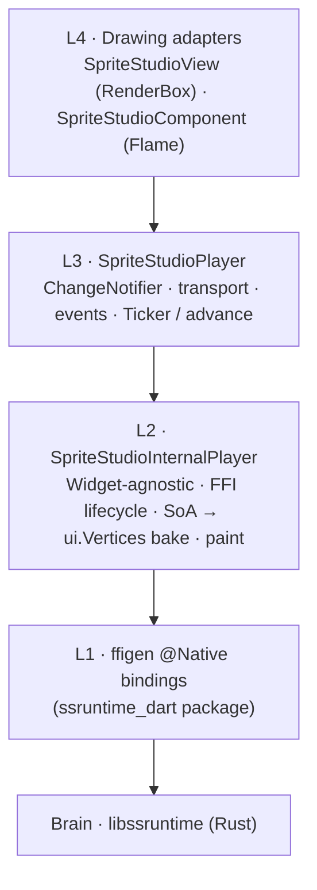

# Architecture

SpriteStudioPlayer for Flutter is the **Body** for the SpriteStudio-SDK **Brain**. The Brain
(`libssruntime`, Rust `no_std`) loads a `.ssab`, advances time, and emits per-frame **SoA buffers**
(world matrices, local vertices / UVs) plus a FlatBuffers **`FrameData`** carrying a **`DrawBatch`**
plan. The Body consumes them over `dart:ffi` and executes the plan as `Canvas.drawVertices` — one
draw per batch. There is no retained scene graph: everything is rebuilt each frame.

## The 4 layers

It is a **strict downward dependency**; layers below are nearer the Brain. Each layer has one job:

| Layer | Responsibility | Lives in |
|---|---|---|
| **L4** | Drawing adapters — `SpriteStudioView` (a `RenderBox`) and the Flame `SpriteStudioComponent` | `ssplayer_flutter`, `ssplayer_flame` |
| **L3** | `SpriteStudioPlayer` — transport / events; a `Ticker` in vsync mode, or externally clocked via `advance` | `ssplayer_flutter` |
| **L2** | `SpriteStudioInternalPlayer` — FFI Resource/Context lifecycle, SoA → `ui.Vertices` bake, `paint` = `DrawBatch.kind` dispatch | `ssplayer_flutter` |
| **L1** | ffigen `@Native` C-API bindings + runtime FlatBuffers | `ssruntime_dart` |

**L2 is kept Widget-free** so it is reusable headless / from Flame / a future `flutter_gpu` backend.

## Where things live

- **L1** — `ssruntime_dart` (pure Dart, non-Flutter): `@Native` C-API bindings
  (`lib/src/ssruntime_bindings.g.dart`, native lib bundled by `hook/build.dart`) + runtime
  FlatBuffers (`framedata` / `effect_draw_plan`).
- **L2–L4** — `ssplayer_flutter` (the public API barrel; import L1 from `ssruntime_dart` directly).
- **Flame L4** — `ssplayer_flame` (a separate package so the core never pulls in `flame`).
- **Converter** — `ssconverter_dart` (host `.sspj` → `.ssab`, desktop-only).

See [Packages](../packages.md) for the full list and their pub.dev roles.

## Rendering model

The Brain emits a `DrawBatch` plan; `paint` dispatches on `DrawBatch.kind`
(`Normal / Mesh / Effect / Instance / Shape`) and bakes each batch into one indexed `ui.Vertices`.
Because the canvas is immediate-mode and everything is rebuilt per frame, the performance levers are
**per-frame allocation** and **draw-call count** — not the batch grouping, which already matches the
Brain's plan. See [Roadmap & Limitations](roadmap.md#performance) for what has been optimized.

## Full design docs

The authoritative design reference — repository layout, the exact per-frame render recipe, per-kind
rules, and the code-verified **kind × cross-cutting feature matrix (§11-A)** — is
[`docs/architecture.ja.md`](https://github.com/cri-middleware/SSPlayerForFlutter/blob/main/docs/architecture.ja.md).
Implementation rules, FFI-lifetime invariants, and the native-assets packaging notes are in
[`AGENTS.md`](https://github.com/cri-middleware/SSPlayerForFlutter/blob/main/AGENTS.md).
