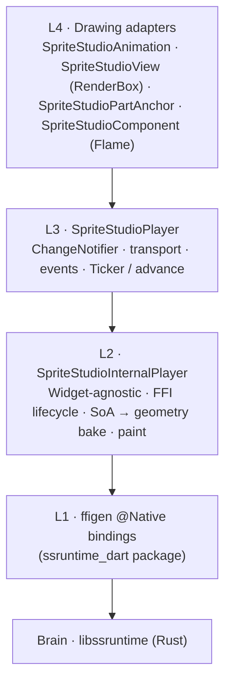

# 🏗️ Architecture

SpriteStudio Player for Flutter is the **Body** for the SpriteStudio-SDK **Brain**. The Brain
(`libssruntime`, Rust `no_std`) loads a `.ssab`, advances time, and emits per-frame **SoA buffers**
(world matrices, local vertices / UVs) plus a FlatBuffers **`FrameData`** carrying a **`DrawBatch`**
plan. The Body consumes them over `dart:ffi` and executes the plan through a pluggable render backend
— `Canvas.drawVertices` or `flutter_gpu` (Impeller). There is no retained scene
graph: everything is rebuilt each frame.

## The 4 layers

It is a **strict downward dependency**; layers below are nearer the Brain. Each layer has one job:

| Layer | Responsibility | Lives in |
|---|---|---|
| **L4** | Drawing adapters — `SpriteStudioAnimation` (a widget that owns its player and ticker), `SpriteStudioView` (a `RenderBox` over a player you own), `SpriteStudioPartAnchor` (a child pinned to a part) and the Flame `SpriteStudioComponent` | `ssplayer_flutter` (`lib/src/render/`), `ssplayer_flame` |
| **L3** | `SpriteStudioPlayer` — transport / events; a `Ticker` in vsync mode, or externally clocked via `advance` | `ssplayer_flutter` |
| **L2** | `SpriteStudioInternalPlayer` — FFI Context lifecycle over one `.ssab` parse shared by every player of the same bytes, SoA → geometry bake (`ui.Vertices` for Canvas / interleaved VBO for GPU), `paint` = `DrawBatch.kind` dispatch | `ssplayer_flutter` |
| **L1** | ffigen `@Native` C-API bindings + runtime FlatBuffers | `ssruntime_dart` |

**L2 is kept Widget-free** so it is reusable headless / from Flame / by either render backend
(`Canvas` or `flutter_gpu`).

## Where things live

- **L1** — `ssruntime_dart` (pure Dart, non-Flutter): `@Native` C-API bindings
  (`lib/src/ssruntime_bindings.g.dart`, native lib bundled by `hook/build.dart`) + runtime
  FlatBuffers (`framedata` / `effect_draw_plan`).
- **L2–L4** — `ssplayer_flutter` (the public API barrel; import L1 from `ssruntime_dart` directly).
- **Flame L4** — `ssplayer_flame` (a separate package so the core never pulls in `flame`).
- **Converter** — `ssconverter_dart` (host `.sspj` → `.ssab`, desktop-only).

See [Packages](../packages.md) for the full list and their roles.

## Rendering model

The Brain emits a `DrawBatch` plan; `paint` dispatches on `DrawBatch.kind`
(`Normal / Mesh / Effect / Instance / Shape`) and delegates each batch to the active **render
backend**. The Brain cuts a batch wherever the part kind changes, so consecutive Normal and Mesh
batches on one texture and blend go to the backend together, and their plain parts draw as one:
Ringo's eight batches a frame are a single draw. Consecutive Effect batches go together too, and
particles of one cellmap and blend draw as one across the effect parts. The `Canvas` backend bakes
each batch, or each such run of them, into one indexed `ui.Vertices` (`Canvas.drawVertices`);
the `flutter_gpu` (Impeller) backend bakes an interleaved VBO and draws through its own pipeline into
an offscreen target. Parts that need a pass of their own — PartColor, integration shaders, and the
multi-pass Sub / Invert blends — are peeled out of their batch and drawn individually on `Canvas`,
whereas the `flutter_gpu` backend batches them. The backend is chosen per `SpriteStudioBackend`
(`auto` picks flutter_gpu where the capability probe passes, else Canvas). Because everything is rebuilt per frame, the performance
levers are **per-frame allocation** and **draw-call count**.

## Why it is built the way it is

Each reason here spans files; the code it points at carries the detail.

**A part's pose reaches a follower as a whole matrix.** `SpriteStudioPartAnchor` hands
`partTransform` to a `Transform` as a `Matrix4` (`render/part_anchor.dart`), so a reflection — a
negative scale on the part or an ancestor — rides along without loss. The Unity and Godot players
decompose the pose into a `Quaternion` / `Transform2D` instead: `Matrix4x4.rotation` is undefined on a
mirrored matrix, and a horizontal flip leaves an extra 180° in the extracted rotation. Code that
decomposes the matrix here takes those caveats on, so it checks `determinant()` first.

**`cancel` is exact here and approximate in the siblings.** Keeping a child unmirrored when the
player is flipped undoes a ±1 diagonal this library applied itself (`SsRootTransform.mirrorCancel` in
`render/root_transform.dart`), so no rotation is left behind. The equivalent in the Unity and Godot
players, with scale not followed (`driveScale` / `update_scale` off), leaves a stray 180° on a
horizontal flip.

**On `flutter_gpu`, each player draws into an offscreen target of its own and is composited.** What
the app paints on the `Canvas` underneath is therefore not the destination a player's blends read;
the other parts of the same animation are. That is why a blend check on the GPU backend compares a
part shown and hidden over the rest of its own animation, not over a painted background.

## Further reading

How the native library is resolved and packaged is on [Native Runtime](native-runtime.md), and how to
build and test from a checkout on the [Build Guide](build.md).
