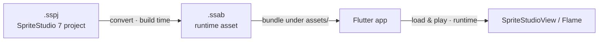

# Preparing Assets (`.sspj` → `.ssab`)

The player renders **`.ssab`** (a parse-free runtime binary), not the editor's `.sspj`. A converter
reads the `.sspj` and its referenced files (`.ssae` / `.ssee` / `.ssqe` / `.ssce`) and produces
`.ssab` (animations) plus, when needed, `.ssqb` (sequence packs). Conversion happens **at build time**;
your app only ever loads the finished `.ssab`.



## Choosing a conversion route

Flutter has no in-editor "import dock" like the Godot / Unity plugins, so conversion is a separate
step. The converter is open source and comes in several forms — a CLI, a desktop GUI, a browser tool,
and an embeddable library — so pick the route that fits your workflow. The Flutter-native `ssconvert`
is the recommended default (it is already in your workspace).

| Route | Best for | Getting it |
|---|---|---|
| [**Auto importer (Live Reload)**](#auto-importer-live-reload) | Iterating during development — auto-convert on save, no manual step | Built in: [`ssgen_flutter`](live-reload.md) |
| [**`ssconvert`**](#ssconvert-ssconverter_dart-recommended) *(recommended)* | CI / build-time / reproducibility, zero install | `dart run ssconverter_dart:ssconvert` |
| [**SSConverterGUI**](#ssconvertergui-desktop-gui) | A simple desktop GUI — drag & drop, batch, embedded toggle | [Download a binary](https://github.com/cri-middleware/SSConverterGUI/releases) |
| [**ssconverter-web**](#ssconverter-web-browser) | A quick one-off in the browser, no install | 🚧 Not yet published (Chromium-only) |
| [**ssconverter-cli**](#ssconverter-cli-sdk) | Language-agnostic CI / non-Dart pipelines | [SDK Releases](https://github.com/cri-middleware/SpriteStudio-SDK/releases), or `cargo install` |

!!! tip "You rarely need a separate binary"
    Because `ssconvert` ships in this workspace and auto-downloads its native converter, most Flutter
    projects never install anything extra. SSConverterGUI, ssconverter-web, and the SDK's
    `ssconverter-cli` are there when a GUI, the browser, or a non-Dart pipeline suits you better —
    they all produce the same `.ssab`.

## `ssconvert` (`ssconverter_dart`) — recommended

Conversion done entirely in Dart by the
[`ssconverter_dart`](https://github.com/cri-middleware/SSPlayerForFlutter/tree/main/packages/ssconverter_dart)
package, which ships the `ssconvert` CLI and an `SsConverter` library. The native `libssconverter` is
auto-downloaded by the package's build hook, so it works out of the box — **no Rust toolchain, no
separate binary**. It is a **desktop-only** host tool (macOS / Windows / Linux).

```bash
dart run ssconverter_dart:ssconvert    -o out/     path/to/project.sspj  # reference-texture form
dart run ssconverter_dart:ssconvert -e -o out_emb/ path/to/project.sspj  # embedded (for distribution)
```

### Reference-texture vs. embedded

| Form | Flag | What you get | When to use |
|---|---|---|---|
| **Reference** | *(default)* | An `.ssab` that references sibling PNG / WebP files | Iterating locally; share textures across packs |
| **Embedded** | `-e` | A single self-contained `.ssab` with textures baked in | Shipping — one file per animation, nothing else to bundle |

Load a reference-form `.ssab` with `baseAssetDir` so the sibling images resolve; an embedded `.ssab`
needs none. See [Quick Start](../guide/quickstart.md).

### In a build / CI pipeline

Because it is a plain `dart run`, it drops into any Dart/Flutter CI job with no extra binaries. Convert
straight into the app's `assets/` directory as part of the build — exactly what
[`scripts/deploy-examples.sh`](https://github.com/cri-middleware/SSPlayerForFlutter/blob/main/scripts/deploy-examples.sh)
does for the example apps. The same engine is also available programmatically via `SsConverter` (from
`package:ssconverter_dart`) for custom Dart tooling.

!!! tip "Keep `.sspj` sources out of the shipped app"
    Manage your SpriteStudio source projects outside the Flutter package (or the repo) and commit only
    the converted `.ssab`. The game never needs the source data.

## Auto importer (Live Reload)

The lowest-friction route while developing: save in SpriteStudio 7 and the running app re-converts and
updates automatically — no manual conversion at all. This is Flutter's equivalent of the Godot / Unity
importers' fast-iteration loop, provided by `ssgen_flutter`. See [Live Reload](live-reload.md).

## SSConverterGUI (desktop GUI)

A simple cross-platform desktop GUI: drag & drop a project, batch-convert, and toggle embedded output.
Download the binary for your OS from
[**SSConverterGUI Releases**](https://github.com/cri-middleware/SSConverterGUI/releases) and run it.
Good when you'd rather not touch a terminal.

## ssconverter-web (browser)

Convert a `.sspj` in the browser and download the result — no install. It runs the WebAssembly build
of the converter client-side.

!!! note "🚧 Not yet published"
    Once released it will be hosted on GitHub Pages
    (<https://cri-middleware.github.io/SSPlayerForWeb/ssconverter/>). Folder selection uses the **File
    System Access API**, so a **Chromium-based browser (Chrome / Edge)** is required.

## ssconverter-cli (SDK)

A native build-time CLI distributed by the SpriteStudio-SDK (a wrapper around the same
`libssconverter`). It fits language-agnostic CI, non-Dart pipelines, and cases that need
reproducibility independent of the Dart toolchain.

- **Prebuilt binary** — download the Windows / macOS / Linux build from
  [**SpriteStudio-SDK Releases**](https://github.com/cri-middleware/SpriteStudio-SDK/releases).
- **Build from source** — with a Rust toolchain, `cargo install --path cli` at the SDK repo root.

```bash
ssconverter-cli project.sspj -o ./assets      # convert with an output directory
ssconverter-cli project.sspj --embedded       # embed textures into the .ssab
```

For its full options, see the
[SDK `ssconverter-cli` README](https://github.com/cri-middleware/SpriteStudio-SDK/blob/main/cli/README.md).
