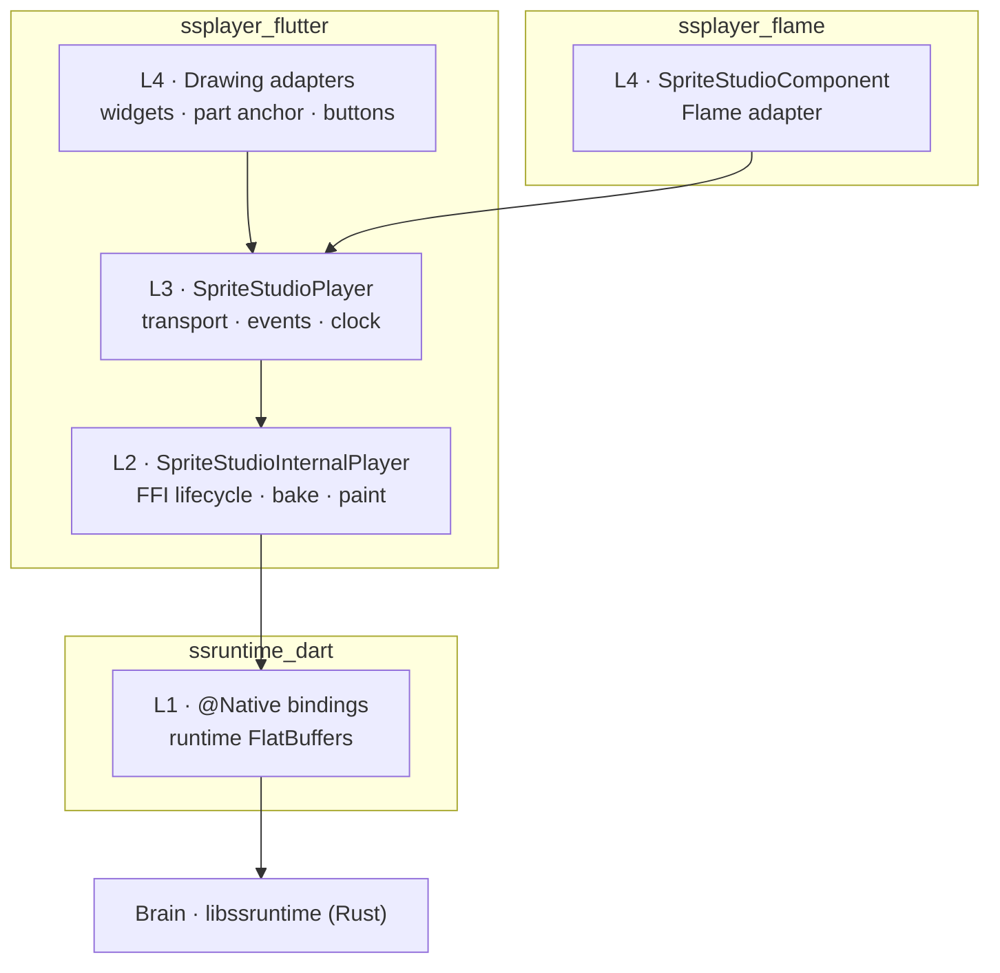
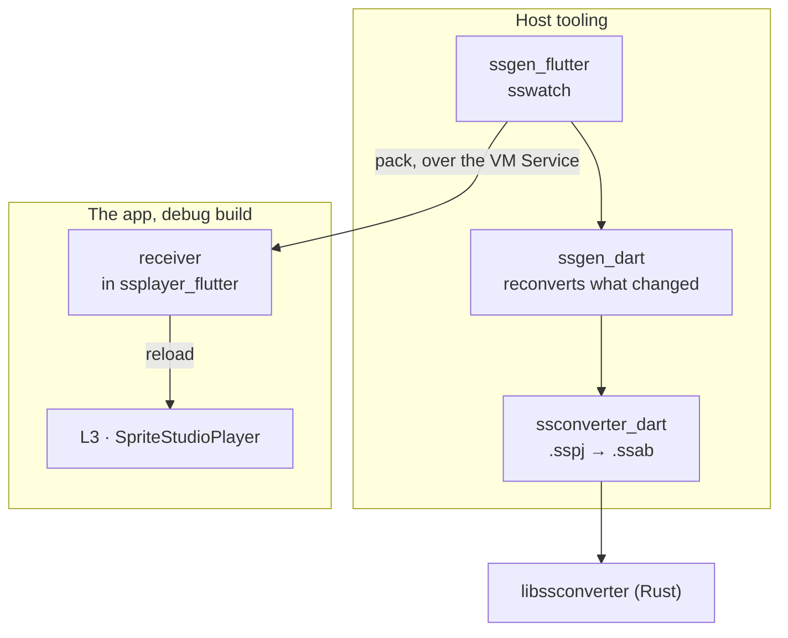

# 🧩 How the Player Is Put Together

SpriteStudio Player for Flutter is the **Body** for the SpriteStudio-SDK **Brain**. The Brain
(`libssruntime`, Rust `no_std`) loads a `.ssab`, advances time, and emits per-frame **SoA buffers**
(world matrices, local vertices / UVs) plus a FlatBuffers **`FrameData`** carrying a **`DrawBatch`**
plan. The Body consumes them over `dart:ffi` and executes the plan through a pluggable render backend
— `Canvas.drawVertices` or `flutter_gpu` (Impeller). There is no retained scene
graph: everything is rebuilt each frame.

## The 4 layers

An arrow is a call, and the dependency is **strictly downward**: layers below are nearer the Brain.

| Layer | Responsibility |
|---|---|
| **L4** | Drawing adapters — `SpriteStudioAnimation` (a widget that owns its player and ticker), `SpriteStudioView` (a `RenderBox` over a player you own), `SpriteStudioPartAnchor` (a child pinned to a part), `SpriteStudioStateView` / `SpriteStudioHitRegion` (an animation inside a button, in `ui.dart`), and the Flame `SpriteStudioComponent` / `SpriteStudioButtonComponent`, which own an externally clocked player. The Flame ones are a package of their own so the core never pulls in `flame` |
| **L3** | `SpriteStudioPlayer` — transport / events; a `Ticker` in vsync mode, or externally clocked via `advance` |
| **L2** | `SpriteStudioInternalPlayer` — FFI Context lifecycle over one `.ssab` parse shared by every player of the same bytes, SoA → geometry bake (`ui.Vertices` for Canvas / interleaved VBO for GPU), `paint` = `DrawBatch.kind` dispatch |
| **L1** | ffigen `@Native` C-API bindings and the runtime's FlatBuffers (`framedata` / `effect_draw_plan`), in pure Dart with no Flutter; the package's build hook bundles the native library |

**L2 is kept Widget-free** so it is reusable headless / from Flame / by either render backend
(`Canvas` or `flutter_gpu`). `ssplayer_flutter` exports L2–L4 from one barrel; code that needs L1
imports it from `ssruntime_dart` directly. [Packages](../packages.md) lists every package with its
role.

## Driving L2 directly

`SpriteStudioInternalPlayer` (L2) carries the reads, overrides and texture calls of `SpriteStudioPlayer`
for a headless run or a drawing adapter of your own:

- **Part overrides** — every method on [Part Overrides](../guide/part-overrides.md), under the same names
  and signatures. `SpriteStudioPlayer` notifies its listeners when a set or clear succeeds, and a paused
  one runs one zero-length tick on the next frame; `SpriteStudioInternalPlayer` does neither. There the
  override shows from the next `update`, `seek` or `setupAnimation` you make, and repainting is yours.
- **Texture replacement** — `setCellmapTexture(hash, image)` and `cellmapTextureOverride(hash)`, keyed
  by hash. L3 repaints on success; L2 leaves that to you.
- **Part reads** — `partWorldMatrix(index)`, `partHidden(index)`, `partQuad(index)` and
  `hitTestPart(point, {parts})`, addressed by index only.

## Live reload

`sswatch` watches the sources, has `ssgen_dart` reconvert the projects that changed, and pushes each
fresh pack into the running app. `ssconverter_dart` is desktop-only — a device cannot convert, so
the host converts and sends the bytes. Only a debug build launched with `SS_LIVE_RELOAD` has the
receiver, and the app never depends on the tooling, so what it ships stays converter-free.

## Rendering model

The Brain emits a `DrawBatch` plan; `paint` dispatches on `DrawBatch.kind`
(`Normal / Mesh / Effect / Instance / Shape`) and delegates each batch to the active **render
backend**. The Brain cuts a batch wherever the part kind changes, so consecutive Normal and Mesh
batches on one texture and blend go to the backend together, and their plain parts draw as one.
Consecutive Effect batches go together too, and
particles of one cellmap and blend draw as one across the effect parts. The `Canvas` backend bakes
each batch, or each such run of them, into one indexed `ui.Vertices` (`Canvas.drawVertices`);
the `flutter_gpu` (Impeller) backend bakes an interleaved VBO and draws through its own pipeline into
an offscreen target. Parts that need a pass of their own — PartColor, integration shaders, and the
multi-pass Sub / Invert blends — are peeled out of their batch and drawn individually on `Canvas`,
whereas the `flutter_gpu` backend batches them. The backend is chosen per `SpriteStudioBackend`
(`auto` picks flutter_gpu where the capability probe passes, else Canvas). Because everything is rebuilt per frame, the performance
levers are **per-frame allocation** and **draw-call count**.

## Why it is built the way it is

Each reason here spans files; the code it concerns carries the detail in its comments.

**A part's pose reaches a follower as a whole matrix.** `SpriteStudioPartAnchor` hands
`partTransform` to a `Transform` as a `Matrix4`, so a reflection — a
negative scale on the part or an ancestor — rides along without loss. The Unity and Godot players
decompose the pose into a `Quaternion` / `Transform2D` instead: `Matrix4x4.rotation` is undefined on a
mirrored matrix, and a horizontal flip leaves an extra 180° in the extracted rotation. Code that
decomposes the matrix here takes those caveats on, so it checks `determinant()` first.

**Undoing the player's flip is exact here, and approximate in the siblings.**
`SpriteStudioAnchorMirror.cancel` (with the scale followed), and an anchor that does not follow the
scale, take out the ±1 diagonal this library applied itself when it flipped the player, so no
rotation is left behind. The equivalent in the Unity and Godot
players, with scale not followed (`driveScale` / `update_scale` off), leaves a stray 180° on a
horizontal flip.

**On `flutter_gpu`, each player draws into an offscreen target of its own and is composited.** What
the app paints on the `Canvas` underneath is therefore not the destination a player's blends read;
the other parts of the same animation are. That is why a blend check on the GPU backend compares a
part shown and hidden over the rest of its own animation, not over a painted background.

## Further reading

How the native library is resolved and packaged is on [Native Runtime](native-runtime.md), and how to
build and test from a checkout on the [Build Guide](build.md).
