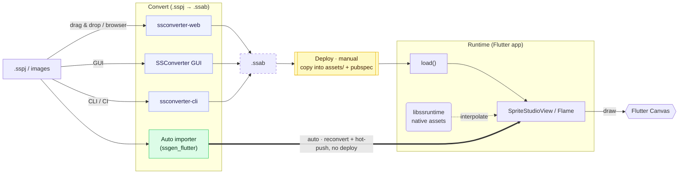

# 🔄 Preparing Assets (`.sspj` → `.ssab`)

The player renders **`.ssab`** (a parse-free runtime binary), not the editor's `.sspj`. A converter
reads the `.sspj` and its referenced files (`.ssae` / `.ssee` / `.ssqe` / `.ssce`) and produces
`.ssab` (animations) plus, when needed, `.ssqb` (sequence packs). Conversion happens **at build time**;
your app only ever loads the finished `.ssab`.



**Only the auto importer is hands-free.** `ssgen_flutter` watches your SpriteStudio sources,
reconverts on save, and pushes the fresh `.ssab` straight into the running app — no manual step. The
browser, GUI, and CLI routes hand you a `.ssab` file that you then **deploy**: copy it under your app's
`assets/` and list it in `pubspec.yaml` (see [Deploy the `.ssab`](#deploy-the-ssab-manual-routes)).

!!! note "Which file becomes which"
    The roles of `.sspj` / `.ssae` / `.ssce` / `.ssqe` and how they map to the output are the same for
    every Player, so they are documented in the portal —
    [Asset Conversion — How a project's files map to the output](https://cri-middleware.github.io/SpriteStudio-Docs/overview/conversion/#how-a-projects-files-map-to-the-output).

    Two points matter. **One `.ssae` becomes one `.ssab`**, and **cell positions are baked from the
    `.ssce` into the `.ssab`**. Because of the latter, whenever you add, move or resize cells, or change
    the image size, **rebuild the `.ssab` and ship it alongside the image** — swapping the image alone
    leaves the old source rectangles in place and the artwork shifts. (With an embedded export there is
    only the one `.ssab` to replace.)

## Reference-texture vs. embedded

Decide this **first** — every route below can emit the `.ssab` in either form:

| Form | Flag | What you get | When to use |
|---|---|---|---|
| **Reference** | *(default)* | An `.ssab` that references sibling PNG / WebP files | Iterating locally; share textures across packs |
| **Embedded** | `-e` / `--embedded` | A single self-contained `.ssab` with textures baked in | Shipping — one file per animation, nothing else to bundle |

Either form loads the same way: `loadAsset('…/Foo.ssab')` resolves sibling reference images from the
key's own folder, and an embedded `.ssab` carries its own. See [Quick Start](quickstart.md).

## Choosing a conversion route

Flutter has no in-editor "import dock" like the Godot / Unity plugins, so conversion is a separate
step. The converter is open source and comes in several forms — an auto-importer, a browser tool, a
desktop GUI, and a CLI — all producing the same `.ssab`. Pick the one that fits your workflow.

!!! tip "No `.sspj` of your own yet?"
    The [official SpriteStudio sample data](https://www.webtech.co.jp/help/ja/spritestudio7/download/sample/) works as-is
    (that page is only available in Japanese; the downloads themselves are language-neutral).
    [Ringo](https://www.webtech.co.jp/help/ja/spritestudio7/download/sample/#ringo) is a good character sample, and
    [Particle](https://www.webtech.co.jp/help/ja/spritestudio7/download/sample/#Perticle_sample) is a good one if you want
    effects. The downloaded project feeds any of the routes below as-is.

| Route | Best for | Getting it |
|---|---|---|
| [**Auto importer (Live Reload)**](#auto-importer-live-reload) | Iterating during development — auto-convert on save, no manual step | Built in: [`ssgen_flutter`](live-reload.md) |
| [**ssconverter-web**](#ssconverter-web-browser) | A quick one-off in the browser, no install | 🚧 Not yet published (Chromium-only) |
| [**SSConverter GUI**](#ssconverter-gui-desktop-gui) | A simple desktop GUI — drag & drop, batch, embedded toggle | [Download a binary](https://github.com/cri-middleware/SSConverterGUI/releases) |
| [**ssconverter-cli**](#ssconverter-cli) | CI / build-time / reproducibility — including the in-workspace Dart `ssconvert` | [SDK Releases](https://github.com/cri-middleware/SpriteStudio-SDK/releases) · `dart run ssconverter_dart:ssconvert` |

!!! tip "Flutter projects rarely install anything extra"
    This repo ships the converter as a Dart package, so `dart run ssconverter_dart:ssconvert`
    (see [ssconverter-cli](#ssconverter-cli)) converts with zero install and auto-downloads its native
    library. The auto-importer, browser tool, and desktop GUI are there when a live loop, the browser,
    or a no-terminal workflow suits you better.

## Auto importer (Live Reload)

The lowest-friction route while developing: save in SpriteStudio and the running app re-converts and
updates automatically — no manual conversion, **and no deploy step** (the fresh pack is pushed straight
into the running app). This is Flutter's equivalent of the Godot / Unity importers' fast-iteration
loop, provided by `ssgen_flutter`. See [Live Reload](live-reload.md).

## ssconverter-web (browser)

Convert a `.sspj` in the browser and download the result — no install. It runs the WebAssembly build
of the converter client-side. Then [deploy](#deploy-the-ssab-manual-routes) the downloaded `.ssab`.

!!! note "🚧 Not yet published"
    Once released it will be hosted on GitHub Pages
    (<https://cri-middleware.github.io/SSPlayerForWeb/ssconverter/>). Folder selection uses the **File
    System Access API**, so a **Chromium-based browser (Chrome / Edge)** is required.

## SSConverter GUI (desktop GUI)

A simple cross-platform desktop GUI: drag & drop a project, batch-convert, and toggle embedded output.
Download the binary for your OS from
[**SSConverter GUI Releases**](https://github.com/cri-middleware/SSConverterGUI/releases) and run it.
Good when you'd rather not touch a terminal. Then [deploy](#deploy-the-ssab-manual-routes) the
converted `.ssab`.

## ssconverter-cli

A native build-time CLI wrapping `libssconverter`. There are two equivalent front-ends — both produce
the same `.ssab`.

### Flutter / Dart — `dart run ssconverter_dart:ssconvert` (recommended, in-workspace)

This repo ships the converter as the
[`ssconverter_dart`](https://github.com/cri-middleware/SSPlayerForFlutter/tree/main/packages/ssconverter_dart)
package, which exposes the `ssconvert` CLI and an `SsConverter` library. Its native `libssconverter`
is auto-downloaded by the package build hook, so it works out of the box — **no Rust toolchain, no
separate binary**. It is a **desktop-only** host tool (macOS / Windows / Linux):

```bash
dart run ssconverter_dart:ssconvert    -o out/     path/to/project.sspj  # reference-texture form
dart run ssconverter_dart:ssconvert -e -o out_emb/ path/to/project.sspj  # embedded (for distribution)
```

Because it is a plain `dart run`, it drops into any Dart/Flutter CI job with no extra binaries. Convert
straight into the app's `assets/` directory as part of the build — exactly what
[`scripts/deploy-examples.sh`](https://github.com/cri-middleware/SSPlayerForFlutter/blob/main/scripts/deploy-examples.sh)
does for the example apps. The same engine is also available programmatically via `SsConverter` (from
`package:ssconverter_dart`) for custom Dart tooling.

!!! tip "Keep `.sspj` sources out of the shipped app"
    Manage your SpriteStudio source projects outside the Flutter package (or the repo) and commit only
    the converted `.ssab`. The game never needs the source data.

### SDK — `ssconverter-cli` (language-agnostic)

The SpriteStudio-SDK distributes a standalone native CLI (the same `libssconverter`) for
language-agnostic CI, non-Dart pipelines, and reproducibility independent of the Dart toolchain.

- **Prebuilt binary** — download the Windows / macOS / Linux build from
  [**SpriteStudio-SDK Releases**](https://github.com/cri-middleware/SpriteStudio-SDK/releases).
- **Build from source** — with a Rust toolchain, `cargo install --path cli` at the SDK repo root.

```bash
ssconverter-cli project.sspj -o ./assets      # convert with an output directory
ssconverter-cli project.sspj --embedded       # embed textures into the .ssab
```

For its full options, see the
[SDK `ssconverter-cli` README](https://github.com/cri-middleware/SpriteStudio-SDK/blob/HEAD/cli/README.md).

## Deploy the `.ssab` (manual routes)

The browser, GUI, and CLI routes leave a `.ssab` on disk — your app still has to bundle it (the auto
importer does this for you):

1. Copy the `.ssab` into your app's assets (e.g. `assets/spritestudio/<name>/`). For **reference-form**
   output, copy its sibling textures alongside it; **embedded** output is a single self-contained file.
2. Register the folder in `pubspec.yaml`:
   ```yaml
   flutter:
     assets:
       - assets/spritestudio/
   ```
3. Load it with `loadAsset('assets/spritestudio/…/Foo.ssab')` — reference textures resolve from the
   key's own folder. See [Quick Start](quickstart.md).

In CI, script step 1 as part of the build — that is exactly what
[`scripts/deploy-examples.sh`](https://github.com/cri-middleware/SSPlayerForFlutter/blob/main/scripts/deploy-examples.sh)
does for the example apps (convert straight into `assets/`).
