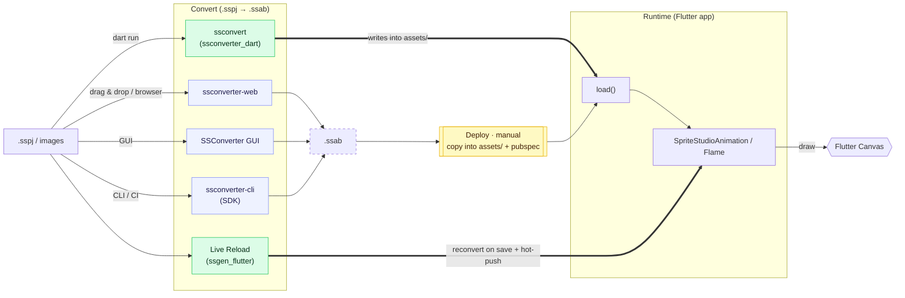

# 🔄 Preparing Assets (`.sspj` → `.ssab`)

The player renders **`.ssab`** (a parse-free runtime binary), not the editor's `.sspj`. A converter
reads the `.sspj` and its referenced files (`.ssae` / `.ssee` / `.ssqe` / `.ssce`) and produces
`.ssab` (animations) plus, when needed, `.ssqb` (sequence packs). Conversion runs **before the app
does** — on your machine or in CI; your app only ever loads the finished `.ssab`.



**The README's route is `ssconvert`.** With `ssconverter_dart` as a dev dependency, one command
converts a project under `SpriteStudio_Source/` straight into your app's `assets/`, and
[Live Reload](live-reload.md) reconverts the same `SpriteStudio_Source/` on save while the app runs.
The browser, GUI and SDK CLI hand you files to [deploy](#deploy-the-ssab-other-routes) by hand.

!!! note "Which file becomes which"
    The roles of `.sspj` / `.ssae` / `.ssce` / `.ssqe` and how they map to the output are the same for
    every Player, so they are documented in the portal —
    [Asset Conversion — How a project's files map to the output](https://cri-middleware.github.io/SpriteStudio-Docs/overview/conversion/#how-a-projects-files-map-to-the-output).

    Two points matter. **One `.ssae` becomes one `.ssab`**, and **cell positions are baked from the
    `.ssce` into the `.ssab`**. Because of the latter, whenever you add, move or resize cells, or change
    the image size, **rebuild the `.ssab` and ship it alongside the image** — swapping the image alone
    leaves the old source rectangles in place and the artwork shifts. (With an embedded export there is
    only the one `.ssab` to replace.)

## Reference-texture vs. embedded

Decide this **first** — every route below can emit the `.ssab` in either form:

| Form | Flag | What you get | When to use |
|---|---|---|---|
| **Reference** | *(default)* | An `.ssab` that references sibling PNG / WebP files | Iterating locally; share textures across packs |
| **Embedded** | `-e` / `--embedded` | A single self-contained `.ssab` with textures baked in | Shipping — one file per animation, nothing else to bundle |

Either form loads the same way: `loadAsset('…/Foo.ssab')` resolves sibling reference images from the
key's own folder, and an embedded `.ssab` carries its own. See [Quick Start](quickstart.md).

## Choosing a conversion route

Every route below runs the same open-source converter and produces the same `.ssab`.

!!! tip "No `.sspj` of your own yet?"
    The [official SpriteStudio sample data](https://www.webtech.co.jp/help/ja/spritestudio7/download/sample/) works as-is
    (that page is only available in Japanese; the downloads themselves are language-neutral).
    [Ringo](https://www.webtech.co.jp/help/ja/spritestudio7/download/sample/#ringo) is a good character sample, and
    [Particle](https://www.webtech.co.jp/help/ja/spritestudio7/download/sample/#Perticle_sample) is a good one if you want
    effects. The downloaded project feeds any of the routes below as-is.

| Route | Best for | Getting it |
|---|---|---|
| [**ssconvert**](#ssconvert-dart) | The README's route — convert `SpriteStudio_Source/` into `assets/`, by hand or in CI | `flutter pub add --dev ssconverter_dart` |
| [**Live Reload**](#live-reload) | Reconverting on save while the app runs, from the same `SpriteStudio_Source/` | [`ssgen_flutter`](live-reload.md) |
| [**ssconverter-web**](#ssconverter-web-browser) | A quick one-off in the browser, no install | [Open in the browser](https://cri-middleware.github.io/SSPlayerForWeb/ssconverter/) (Chromium-only) |
| [**SSConverter GUI**](#ssconverter-gui-desktop-gui) | A desktop GUI — drag & drop, batch, embedded toggle | [Download a binary](https://github.com/cri-middleware/SSConverterGUI/releases) |
| [**ssconverter-cli**](#ssconverter-cli-sdk) | Non-Dart pipelines | [SDK Releases](https://github.com/cri-middleware/SpriteStudio-SDK/releases) |

## ssconvert (Dart)

[`ssconverter_dart`](https://github.com/cri-middleware/SSPlayerForFlutter/tree/main/packages/ssconverter_dart)
is a dev dependency, added as on [Installation](install.md), that exposes the `ssconvert` CLI and an
`SsConverter` library. Its native `libssconverter` is downloaded by the package build hook, so it needs
**no Rust toolchain and no separate binary**. It is a **desktop-only** host tool (macOS / Windows /
Linux). Convert straight into your assets:

```bash
dart run ssconverter_dart:ssconvert    -o assets/spritestudio/Ringo/     SpriteStudio_Source/Ringo/Ringo.sspj  # reference-texture form
dart run ssconverter_dart:ssconvert -e -o assets/spritestudio/Ringo_emb/ SpriteStudio_Source/Ringo/Ringo.sspj  # embedded (for distribution)
```

Then list the folder in `pubspec.yaml` (step 2 of [Deploy the `.ssab`](#deploy-the-ssab-other-routes)).
Because it is a plain `dart run`, it drops into any Dart/Flutter CI job. The same engine is available
programmatically via `SsConverter` (from `package:ssconverter_dart`) for custom Dart tooling.

!!! tip "The sources stay out of the app"
    Only the folders listed under `flutter: assets:` are bundled, so `SpriteStudio_Source/` never
    ships with the app.

## Live Reload

Save in SpriteStudio and the running app reconverts and updates — `ssgen_flutter` watches the same
`SpriteStudio_Source/`, writes into `assets/spritestudio/`, and pushes the fresh pack into the running
app. See [Live Reload](live-reload.md).

## ssconverter-web (browser)

Convert a `.sspj` in the browser and download the result — no install. It runs the WebAssembly build
of the converter client-side, and the ZIP holds one folder named after the `.sspj`. Then
[deploy](#deploy-the-ssab-other-routes) it.

!!! note "Chromium-based browsers only"
    It is hosted on GitHub Pages: <https://cri-middleware.github.io/SSPlayerForWeb/ssconverter/>.
    Folder selection uses the **File System Access API**, so a
    **Chromium-based browser (Chrome / Edge)** is required.

## SSConverter GUI (desktop GUI)

A simple cross-platform desktop GUI: drag & drop a project, batch-convert, and toggle embedded output.
Download the binary for your OS from
[**SSConverter GUI Releases**](https://github.com/cri-middleware/SSConverterGUI/releases) and run it.
Then [deploy](#deploy-the-ssab-other-routes) the converted `.ssab`.

## ssconverter-cli (SDK)

The SpriteStudio-SDK distributes a standalone native CLI (the same `libssconverter`) for non-Dart
pipelines.

- **Prebuilt binary** — download `ssconverter-cli-<platform>.zip` (Windows / macOS / Linux) from the
  **Assets** of a [**SpriteStudio-SDK Release**](https://github.com/cri-middleware/SpriteStudio-SDK/releases).
- **Build from source** — with a Rust toolchain, `cargo install --path cli` at the SDK repo root.

```bash
ssconverter-cli project.sspj -o ./assets      # convert with an output directory
ssconverter-cli project.sspj --embedded       # embed textures into the .ssab
```

For its full options, see the
[SDK `ssconverter-cli` README](https://github.com/cri-middleware/SpriteStudio-SDK/blob/HEAD/cli/README.md).

## Deploy the `.ssab` (other routes)

`ssconvert` and Live Reload write into `assets/` themselves. The browser, GUI and SDK CLI leave files
on disk for you to place:

1. Copy the output into your app's assets (e.g. `assets/spritestudio/<name>/`). For **reference-form**
   output, copy its sibling textures alongside it; **embedded** output is a single self-contained file.
2. Register the folder in `pubspec.yaml`, one line per folder: a Flutter asset entry does not take
   in its subfolders, so a `font/` or `sound/` folder the converter writes beside the `.ssab` needs a
   line of its own.
   ```yaml
   flutter:
     assets:
       - assets/spritestudio/<name>/
   ```
3. Load it with `loadAsset('assets/spritestudio/…/Foo.ssab')` — reference textures resolve from the
   key's own folder. See [Quick Start](quickstart.md).
