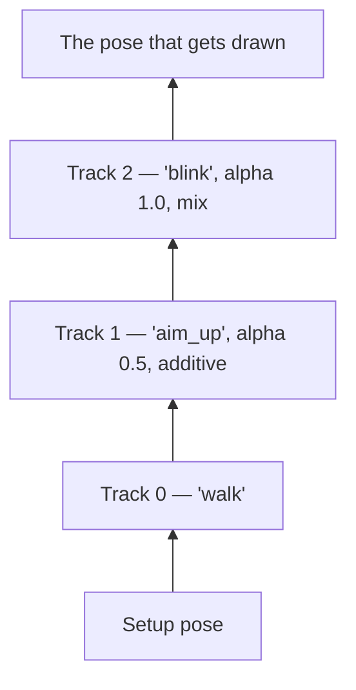

# 🎚️ Motion Blending

Play several animations on one character at once, and move between them without a cut: a walk
underneath, an aim laid over it, a one-shot reaction crossfading in — from animations an animator
authored separately.

Every call here needs the pack, so with `SpriteStudioAnimation` make them from `onLoaded`.

## The model: a stack of tracks { #tracks }

Tracks fold onto the **setup pose** (the rest pose the animation data defines) in ascending order. Each one plays an animation, with an **alpha**
(how much of it survives onto the pose below) and a **blend**.



**Track 0 is the character's.** It plays the animation `setAnimation` chose, and the player reports
it: `currentAnimation`, `isFinished`, the frame read-outs and the events all follow track 0. The
tracks above it are overlays.

| Blend | What it does |
|---|---|
| `SsTrackBlend.mix` | Lerps toward the track's pose. At alpha 1 the track wins outright |
| `SsTrackBlend.additive` | Adds the track's **offset from the setup pose**, so what is underneath still shows through — the blend for an aim, a lean, a breath |

## Laying an overlay

```dart
_player.setAnimation('walk');        // track 0
_player.play();

_player.setTrackAnimation(1, 'aim_up');               // an overlay
_player.setTrackBlend(1, SsTrackBlend.additive);
_player.setTrackAlpha(1, 0.5);                        // half strength

// ... and take it off again
_player.clearTrack(1);
```

`clearTrack` refuses track 0 — fade it to alpha 0 instead, which settles the character onto the setup
pose.

Every track call returns `false` (or a read returns `null`) before `load` or when the runtime refuses
it, and `setTrackAlpha`, `setTrackBlend` and `fadeTrack` do so for a track that does not exist, so lay
an animation on it first. The calls that lay one (`setTrackAnimation`, `crossfade`, `addTrackSource`)
and the per-track settings create the track instead. None of them throws. A refusal is also logged once — the
call, the track or source, the animation name it was given and the runtime's reason — so a misspelt
name does not leave the previous animation playing in silence.

> [!WARNING] `setAnimation` folds the stack
> Switching track 0 with `setAnimation` takes every overlay, fade and [source](#sources) with it, and resets
> every track's alpha, blend and sync. Lay overlays again after it — or switch with a
> [crossfade](#crossfade), which keeps them.

## Fading rather than cutting { #crossfade }

Both fades run on the player's clock: start one and keep playing.

```dart
// Swap what a track plays over 400 ms, from wherever it is now.
_player.crossfade(0, 'run', const Duration(milliseconds: 400));

// Drive a track's alpha somewhere over 250 ms.
_player.fadeTrack(1, 0.0, const Duration(milliseconds: 250)); // fade the overlay out
_player.fadeTrack(0, 0.0, const Duration(milliseconds: 600)); // settle onto the setup pose

final t = _player.trackFadeProgress(0); // 0..1, or null when not fading
_player.cancelTrackFade(1);
```

### What a crossfade on track 0 changes, and when

The incoming animation takes track 0 over **when the fade begins**, not when it ends:

* `currentAnimation` names it straight after the call, so `setAnimation` with the name the fade left
  behind switches back rather than doing nothing. `canvasSize` follows it too.
* Its cells, visibility and other values that cannot be blended show from the first frame of the
  fade. Its state is what `isFinished` and `onAnimationFinished` report: the outgoing animation running
  out during the fade does not finish the player.
* Its events fire from the start, and the outgoing animation's fall silent (see [Events](#events)).
* It plays with the speed, frame rate, frame skip, direction and `loopCount` you set, as if
  `setAnimation` had switched to it. Its section is its own whole length.
* Unlike `setAnimation` it does not rewind or stop anything: the clock keeps running, and the
  other tracks stay as they are. It does not fire `onAnimationStarted`.

Everything the track was playing fades out together, keeping its proportions. A second `crossfade`
during a fade takes the fade in flight over as it stands, so the pose does not jump — nor does one
after `cancelTrackFade`, or from a track mixing several animations.

> [!NOTE] The instance and effect parts carry on
> A crossfade is a fade rather than a switch, so the instance children and effects keep running
> under the incoming animation. Which key drives them from the handover on is outside motion
> blending (see [Limits](#limits)).

### With `SpriteStudioAnimation`

The widget switches track 0 from its `animation` parameter. Give it a `transition` and a change of
`animation` crossfades instead of switching:

```dart
SpriteStudioAnimation.asset(
  'assets/spritestudio/Hero/Hero.ssab',
  animation: _running ? 'run' : 'walk',
  transition: const Duration(milliseconds: 200),
)
```

Switch track 0 under the widget through these parameters, not by calling `crossfade(0, …)` on its
player: the parameter would keep naming the old animation, and setting it back to that name would
then be no change. The tracks above 0 are the player's to drive.

## Several animations on one track { #sources }

A track can carry more than one animation, mixed by **weight** — the way a walk and a run blend by how
fast the character moves. Each one is a *source*, named by a handle:

```dart
_player.setAnimation('walk');
_player.play();
final walk = _player.trackMainSource(0)!;
final run = _player.addTrackSource(0, 'run', 0.0)!; // beside the walk, silent for now

// every frame, from the character's speed
final t = (speed / runSpeed).clamp(0.0, 1.0);
_player.setSourceWeight(walk, 1.0 - t);
_player.setSourceWeight(run, t);
```

* Weights are **ratios within the track**: 0.7 / 0.3 and 7 / 3 mix alike. The track's strength is
  still its alpha.
* A walk and a run of different lengths drift apart. Lay the run with the track's sync at
  `SsTrackSync.start` (below) to start it in step, or seek it with `setSourceFrame`.
* A handle stays valid until its source is released — a crossfade completing, `setTrackAnimation` or
  `clearTrack` on its track, `setAnimation` — and is then reused, so do not hold one past that.

## Starting in step with track 0 { #sync }

An animation laid on a track starts from the head of its section, so a run laid over a walk half-way
through its stride puts the feet out of step. Set the track's **sync** to `SsTrackSync.start` and what
is laid on it next starts at the **phase** track 0 stands at — how far through its section it is, as a
fraction — so animations of different lengths line up by proportion:

```dart
_player.setTrackSync(0, SsTrackSync.start); // before laying
_player.crossfade(0, 'run', const Duration(milliseconds: 400)); // run starts at the walk's phase
```

| Sync | Where a laid animation starts | Suited to |
|---|---|---|
| `SsTrackSync.free` (default) | The head of its section | One-off motions: a blink, a mouth shape, a hit reaction |
| `SsTrackSync.start` | The same fraction of its section as track 0's animation | Cyclic motions over each other: a walk and a run |

* It applies to everything laid on the track afterwards — `setTrackAnimation`, `crossfade` and
  `addTrackSource` — track 0 included, where the incoming animation starts at the outgoing one's phase.
* It aligns **once**, when the animation is laid. Both then run on one clock, so animations of the same
  length and speed stay in step, and different ones drift apart again.
* It belongs to the track, like its alpha and blend: `setAnimation` resets it.

## A track's playback settings

The speed, the frame-rate override, frame skip and the direction belong to the **track**, not to the
animation on it. They reach every animation on the track — both sides of a crossfade included — and
every one laid on it later.

```dart
_player.setTrackSpeed(1, 0.5);
_player.setTrackFrameRate(1, 24);
_player.setTrackFrameSkipEnabled(1, false);
_player.setTrackPlaybackDirection(
    1, SsPlaybackDirection.forward, SsPlaybackStyle.pingPong);
```

Track 0's are the transport you already have: `speedScale` is track 0's `setTrackSpeed`, `frameRate`
its `setTrackFrameRate`, and so on. Writing track 0 through either keeps both in step.

The **loop count** is the animation's, not the track's: laying an animation starts it looping forever,
so state the count after laying it, and watch the track end. Track 0's is `loopCount`, which
`setTrackLoopCount(0, …)` writes too, and the player puts it back on every animation track 0 switches
to.

```dart
_player.setTrackAnimation(2, 'hit_react');
_player.setTrackLoopCount(2, 1); // once, then hold the last frame

// each frame
if (_player.isTrackFinished(2)) {
  // a finished track holds its last frame until you act
  _player.fadeTrack(2, 0.0, const Duration(milliseconds: 120));
}
```

`trackJustLooped(track)` is the per-advance pulse, as `justLooped` is for track 0. A track above 0
finishing or looping has no callback; only track 0's end fires `onAnimationFinished`, and only track
0's end finishes the character.

Track 0 finishing does not stop the clock, either: overlays, sources added beside a main one and fades
keep moving, and the player keeps its ticker running while any of them moves the pose. One at speed 0,
at weight 0 or on a silent track does not, and lets the ticker stop. `pause`, `resume` and `stop` act on the whole character, every track and
fade at once, while `play` heads out track 0 alone. `isPlaying` and `isPausing` describe track 0,
though, so once track 0 has finished both stay false, through a pause as well.

## Scrubbing a track: continuous control

Author a control axis as an animation — a head turning from full left to full right, an eyelid
opening — then do not *play* it. **Scrub it** with whatever value you track:

```dart
_player.setTrackAnimation(1, 'look_lr');
_player.setTrackBlend(1, SsTrackBlend.additive);
_player.setTrackSpeed(1, 0);           // it does not advance on its own
_player.setTrackFrame(1, headYawFrame); // ... you drive it
```

The animator authors the extremes; the app picks the point between them. Author the axis so that its
middle frame matches the setup pose: the additive blend adds the offset from it, so the middle frame
is the neutral position.

## Events { #events }

By default **only track 0's animation fires events**, and on a crossfade on track 0 that is the incoming
one from the moment the fade begins. Each decoded event names the source that fired it in `source`.

* An overlay, or another source on a track, fires when you lower its threshold to its weight or below:
  `setSourceEventThreshold(handle, 0)`.
* The outgoing side of a crossfade fires while its share of the track, `1 - progress`, is at least the
  track's `setTrackOutgoingEventThreshold`. The default, infinity, silences it the moment the fade
  begins; `0.5` keeps it firing for the first half.

> [!WARNING] If you count events
> A crossfade on track 0 hands the events over when it begins: the outgoing animation stops firing,
> and the incoming one fires from its first frame. Code that counted on the outgoing animation firing
> to the end of the fade needs `setTrackOutgoingEventThreshold`.

## A worked shape

| Track | Animation | Blend | Driven by |
|---|---|---|---|
| 0 | `idle` / `walk` / `run` | — | `crossfade(0, …)` on a state change |
| 1 | `aim_lr` | additive, speed 0 | `setTrackFrame` from the aim angle |
| 2 | `hit_react` | mix | `setTrackAnimation` + `setTrackLoopCount(2, 1)`, faded out once `isTrackFinished(2)` |

Read the stack back with `trackCount`, `trackAlpha`, `trackBlend`, `trackSync`, `trackFrame`,
`trackSpeed`, `trackLoopCount` and the other `track…` reads.

## Limits { #limits }

* **Instance children are not layered.** A part that plays another animation runs its own playback,
  driven by its slot from the character's frame; tracks apply to the character whose player you hold.
  The same goes for effect parts, and for which key drives either kind of child across a crossfade on
  track 0.
* A track's **alpha** is its strength. Where several animations share one track, a source's weight only
  sets proportions among them — it is not a second volume control.
* `reload` rebuilds the player on the new bytes and keeps the transport, not the stack: lay the tracks
  again after it.
