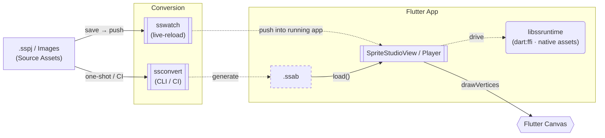

# 📱 SpriteStudioPlayer for Flutter

Play **SpriteStudio** raster (sprite) animations (`.ssab`) natively in Flutter — rigged by
an artist in a dedicated editor, drawn straight to the Flutter `Canvas`, with no animation code to
hand-write. Playback runs through `libssruntime` provided by
[SpriteStudio-SDK](https://github.com/cri-middleware/SpriteStudio-SDK).

!!! tip "New to SpriteStudio?"
    [SpriteStudio](https://www.webtech.co.jp/spritestudio/) is a professional 2D **raster**
    animation editor: bone rigs, mesh deformation, and particle effects applied to raster sprite
    art. Your artist authors the motion visually; this player plays the finished file. It is a
    different fit from vector animation tools, and lighter than shipping a `.gif` or `.mp4`.

!!! example "Try it in a browser"
    Two [**live Web demos**](demo/) are published beside these pages: the `examples/overall`
    app driving the `ssplayer_flutter` widget, and the `examples/flame` one driving
    `ssplayer_flame` — both built for the web, both on the same `libssruntime` wasm a Flutter
    web build loads. The Web target is a developer preview; see
    [Limitations & Scope](limitations.md).

## Table of Contents

- **Setup**
    - [Installation](guide/install.md)
    - [Build Guide](contributing/build.md)
- **Workflow**
    - [Quick Start](guide/quickstart.md)
    - [Playback & Events](guide/playback.md)
    - [Part Overrides](guide/part-overrides.md)
    - [Flame Integration](guide/flame.md)
    - [Preparing Assets (`.sspj` → `.ssab`)](guide/conversion.md) (start here for the initial import)
    - [Live Reload](guide/live-reload.md)
- [**API Reference**](api.md)
- [**Limitations & Scope**](limitations.md)
- **For Contributors**
    - [Architecture](contributing/architecture.md)
    - [Native Runtime](contributing/native-runtime.md)
    - [Releasing](contributing/releasing.md)
- [**Packages**](packages.md)

## Key Features

This player is designed to bring the full expressive power of SpriteStudio to Flutter with zero
animation code to write by hand.

*   **Zero animation code:** Characters, **UIs, and whole scenes** are authored in SpriteStudio; you just call `play()`.
*   **Full feature support:** Ships every core draw kind — Normal, PartColor, Mask, Mesh, Effect (particles), Instance, and Shape — plus bone hierarchies and mesh deformation.
*   **Native GPU-accelerated drawing:** `dart:ffi` into the Rust runtime, drawn through Flutter's own renderer — `flutter_gpu` (Impeller) where available, `Canvas.drawVertices` otherwise. Not a WebView, not a video decode.
*   **Composes with the widget tree — and [Flame](guide/flame.md):** `SpriteStudioView` is a plain `RenderBox`; the `ssplayer_flame` package adds a `SpriteStudioComponent`.
*   **Smooth sub-frame interpolation:** Playback follows the display refresh rate, not a fixed fps — buttery-smooth even in slow motion.
*   **Bring your own art, with live-reload:** Convert `.sspj` → `.ssab` from a [CLI or CI](guide/conversion.md), and **[live-reload](guide/live-reload.md)** editor edits straight into the running app.
*   **High performance & low memory:** A SIMD-optimized runtime and zero-parse binary format (`.ssab`); the native runtime is bundled automatically via native assets — no CocoaPods, no manual linking.

## Overview

The diagram below shows how data flows from authored assets to on-screen playback.

## Supported Versions

- **Flutter**: 3.47 or later — **Dart**: 3.13 or later. Native assets has been stable and default-on since 3.38; the floor sits at 3.47 because that is where flutter_gpu's current GPU API landed, and the GPU backend is built against it.
- **Platforms**: verified on macOS, iOS (simulator), Android (emulator), and Web (developer preview). A physical iOS device and the 32-bit `armeabi-v7a` ABI are not yet confirmed.

## Samples

Sample apps live under the `examples/` folder in the repository.

- [overall](https://github.com/cri-middleware/SSPlayerForFlutter/tree/main/examples/overall) — comprehensive validation app (`flutter run -d macos` → `[ssplayer] OK`).
- [flame](https://github.com/cri-middleware/SSPlayerForFlutter/tree/main/examples/flame) — a `FlameGame` playing an animation via `ssplayer_flame`.

## Related Repositories

- [SpriteStudio Docs](https://cri-middleware.github.io/SpriteStudio-Docs/) — the documentation portal for the SDK and its official players.
- [SpriteStudio-SDK](https://github.com/cri-middleware/SpriteStudio-SDK) — the SDK itself, providing `libssruntime` / `libssconverter`.
- [SSConverterGUI](https://github.com/cri-middleware/SSConverterGUI) — a standalone desktop GUI for converting `.sspj` without a player.

## License

See [LICENSE.md](https://github.com/cri-middleware/SSPlayerForFlutter/blob/main/LICENSE.md).

For third-party library licenses (such as FlatBuffers and SpriteStudio-SDK dependencies), see [THIRD_PARTY_NOTICES.md](https://github.com/cri-middleware/SSPlayerForFlutter/blob/main/THIRD_PARTY_NOTICES.md).
