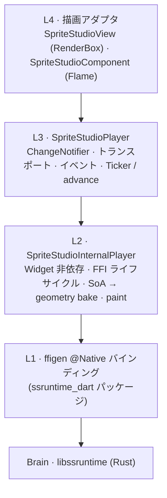

# 🏗️ アーキテクチャ

SpriteStudio Player for Flutter は、SpriteStudio-SDK の **Brain** に対する **Body** です。Brain
（`libssruntime`、Rust `no_std`）が `.ssab` を読み込んで時間を進め、フレームごとの **SoA バッファ**（ワールド行列・ローカル頂点 / UV）と、**`DrawBatch`** プランを載せた FlatBuffers の **`FrameData`**
を出力します。Body はそれを `dart:ffi` で受け取り、差し替え可能なレンダーバックエンド（`Canvas.drawVertices` または `flutter_gpu`（Impeller））でプランを実行します。保持シーングラフは持たず、毎フレーム作り直します。

## 4 レイヤー

**下方向への厳格な依存**で、下のレイヤーほど Brain に近い。各レイヤーの役割は 1 つずつ:

| レイヤー | 役割 | 所在 |
|---|---|---|
| **L4** | 描画アダプタ —— `SpriteStudioView`（`RenderBox`）と Flame の `SpriteStudioComponent` | `ssplayer_flutter`, `ssplayer_flame` |
| **L3** | `SpriteStudioPlayer` —— トランスポート / イベント。vsync モードでは `Ticker`、外部クロックでは `advance` | `ssplayer_flutter` |
| **L2** | `SpriteStudioInternalPlayer` —— FFI Resource/Context ライフサイクル、SoA → geometry bake（Canvas は `ui.Vertices`、GPU はインターリーブ VBO）、`paint` = `DrawBatch.kind` ディスパッチ | `ssplayer_flutter` |
| **L1** | ffigen `@Native` C-API バインディング + ランタイム FlatBuffers | `ssruntime_dart` |

**L2 は Widget 非依存**に保つことで、ヘッドレス / Flame / どちらのレンダーバックエンド（`Canvas` / `flutter_gpu`）からも再利用できます。

## どこに何があるか

- **L1** —— `ssruntime_dart`（純 Dart・非 Flutter）: `@Native` C-API バインディング（`lib/src/ssruntime_bindings.g.dart`）+ ランタイム
  FlatBuffers（`framedata` / `effect_draw_plan`）。ネイティブは `hook/build.dart` が同梱。
- **L2–L4** —— `ssplayer_flutter`（公開 API のバレル。L1 は `ssruntime_dart` から直接 import）。
- **Flame L4** —— `ssplayer_flame`（コアが `flame` を巻き込まないよう別パッケージ）。
- **コンバータ** —— `ssconverter_dart`（ホスト `.sspj` → `.ssab`、デスクトップ専用）。

一覧と pub.dev 上の役割は [パッケージ](../packages.md) を参照してください。

## 描画モデル

Brain が `DrawBatch` プランを出し、`paint` は `DrawBatch.kind`
（`Normal / Mesh / Effect / Instance / Shape`）で分岐して、各バッチをアクティブな**レンダーバックエンド**に委譲します。`Canvas` バックエンドは各バッチを 1 つの indexed `ui.Vertices`（`Canvas.drawVertices`）に
bake し、`flutter_gpu`（Impeller）バックエンドはインターリーブ VBO を bake して自前のパイプラインでオフスクリーンに描画します。独立したパスを要するパーツ —— PartColor・統合シェーダ・マルチパスの
Sub / Invert 合成 —— は、`Canvas` ではバッチから切り出して個別に描画し、`flutter_gpu` バックエンドではまとめて描画します。バックエンドは `SpriteStudioBackend` に応じて選択されます（`auto` は capability
プローブが通れば flutter_gpu、通らなければ Canvas）。毎フレーム作り直すため、性能のレバーは**毎フレームのアロケーション** と **ドローコール数** です（バッチのまとめ方ではありません —— それは既に Brain のプランと一致）。

## さらに詳しく

ネイティブライブラリの解決と同梱は [ネイティブランタイム](native-runtime.md)、チェックアウトからのビルドとテストは [ビルドガイド](build.md) にあります。
