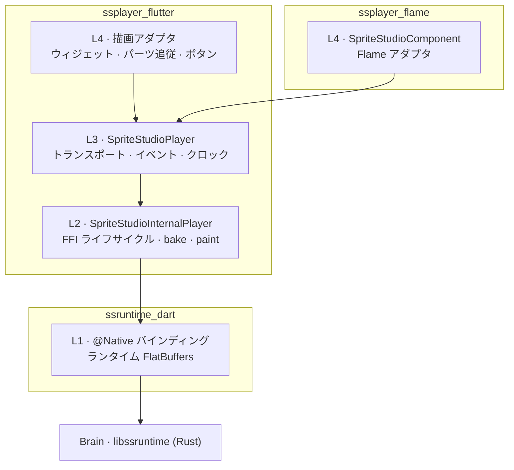
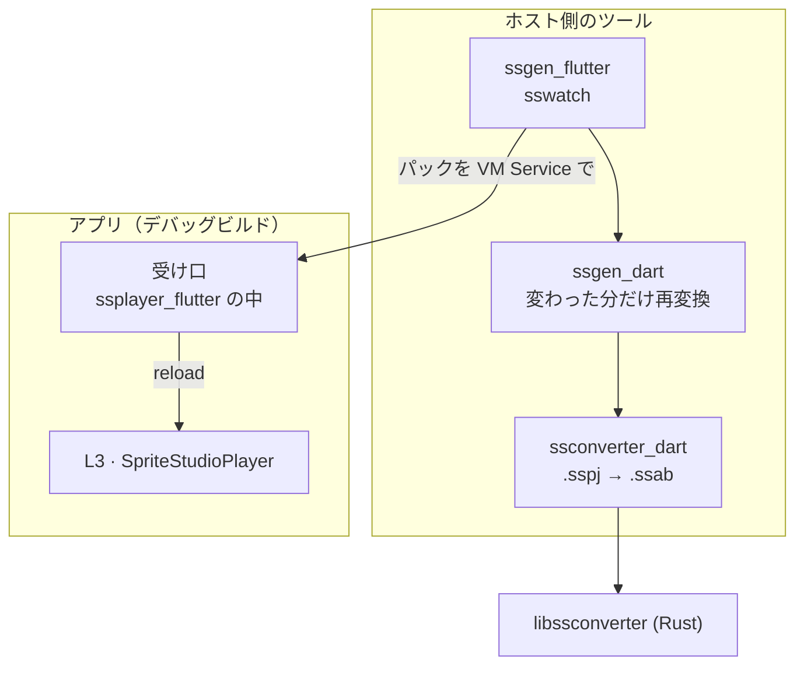

# 🧩 プレイヤーの構成

SpriteStudio Player for Flutter は、SpriteStudio-SDK の **Brain** に対する **Body** です。Brain（`libssruntime`、Rust `no_std`）が `.ssab` を読み込んで時間を進め、フレームごとの **SoA バッファ**（ワールド行列・ローカル頂点 / UV）と、**`DrawBatch`** プランを載せた FlatBuffers の **`FrameData`** を出力します。Body はそれを `dart:ffi` で受け取り、差し替え可能なレンダーバックエンド（`Canvas.drawVertices` または `flutter_gpu`（Impeller））でプランを実行します。保持シーングラフは持たず、毎フレーム作り直します。

## 4 レイヤー

矢印は呼び出しで、依存は**下方向だけ**です。下のレイヤーほど Brain に近くなります。

| レイヤー | 役割 |
|---|---|
| **L4** | 描画アダプタ —— `SpriteStudioAnimation`（プレイヤーと Ticker を自分で持つウィジェット）、`SpriteStudioView`（利用者が持つプレイヤーを描く `RenderBox`）、`SpriteStudioPartAnchor`（パーツに留める子）、`SpriteStudioStateView` / `SpriteStudioHitRegion`（ボタンの中のアニメ。`ui.dart`）、Flame の `SpriteStudioComponent` / `SpriteStudioButtonComponent`（外部クロックのプレイヤーを持つ）。Flame のものは、コアが `flame` を巻き込まないよう別パッケージ |
| **L3** | `SpriteStudioPlayer` —— トランスポート / イベント。vsync モードでは `Ticker`、外部クロックでは `advance` |
| **L2** | `SpriteStudioInternalPlayer` —— FFI Context のライフサイクル（`.ssab` の解析は、同じバイト列の Player すべてで 1 つを共有）、SoA → geometry bake（Canvas は `ui.Vertices`、GPU はインターリーブ VBO）、`paint` = `DrawBatch.kind` ディスパッチ |
| **L1** | ffigen `@Native` C-API バインディングとランタイムの FlatBuffers（`framedata` / `effect_draw_plan`）。Flutter に依存しない純 Dart。ネイティブライブラリはパッケージのビルドフックが同梱 |

**L2 は Widget 非依存**に保つことで、ヘッドレス / Flame / どちらのレンダーバックエンド（`Canvas` / `flutter_gpu`）からも再利用できます。`ssplayer_flutter` は L2–L4 を 1 つのバレルから公開し、L1 が要るコードは `ssruntime_dart` から直接 import します。全パッケージと役割は [パッケージ](../packages.md) にあります。

## L2 を直接使う { #driving-l2-directly }

`SpriteStudioInternalPlayer`（L2）は、`SpriteStudioPlayer` の読み取り・オーバーライド・テクスチャの呼び出しを、ヘッドレス実行や独自の描画アダプタ向けに持っています。

- **パーツオーバーライド** —— [パーツオーバーライド](../guide/part-overrides.md)のメソッドすべてを、同じ名前・同じ引数で持ちます。`SpriteStudioPlayer` は設定・解除が成功するとリスナーへ通知し、一時停止中なら次のフレームで 0 秒の tick を 1 回実行しますが、`SpriteStudioInternalPlayer` はどちらも行いません。呼び出し側が次に `update`・`seek`・`setupAnimation` を呼んだときから反映され、再描画も呼び出し側の責任です。
- **テクスチャ差し替え** —— `setCellmapTexture(hash, image)` と `cellmapTextureOverride(hash)`。ハッシュで指定します。L3 は成功時に再描画し、L2 は再描画を呼び出し側に委ねます。
- **パーツの読み取り** —— `partWorldMatrix(index)`・`partHidden(index)`・`partQuad(index)`・`hitTestPart(point, {parts})`。インデックス指定のみです。

## ライブリロード

`sswatch` はソースを監視し、変わったプロジェクトを `ssgen_dart` に変換し直させて、できたパックを実行中のアプリへ送ります。`ssconverter_dart` はデスクトップ専用です。端末の上では変換できないので、ホストで変換してバイト列を送ります。受け口があるのは `SS_LIVE_RELOAD` を付けて起動したデバッグビルドだけで、アプリはツールに依存しないので、出荷するものにコンバータは入りません。

## 描画モデル

Brain が `DrawBatch` プランを出し、`paint` は `DrawBatch.kind`
（`Normal / Mesh / Effect / Instance / Shape`）で分岐して、各バッチをアクティブな**レンダーバックエンド**に委譲します。Brain はパーツの種類が変わるたびにバッチを切るため、テクスチャと合成が同じ Normal / Mesh のバッチが続く区間はまとめてバックエンドに渡り、素のパーツは 1 回で描画されます。Effect のバッチが続く区間も同様にまとめて渡り、セルマップと合成が同じパーティクルはエフェクトパーツをまたいで 1 回で描画されます。`Canvas` バックエンドは各バッチ（またはそうしたバッチの連なり）を 1 つの indexed `ui.Vertices`（`Canvas.drawVertices`）に
bake し、`flutter_gpu`（Impeller）バックエンドはインターリーブ VBO を bake して自前のパイプラインでオフスクリーンに描画します。独立したパスを要するパーツ —— PartColor・統合シェーダ・マルチパスの
Sub / Invert 合成 —— は、`Canvas` ではバッチから切り出して個別に描画し、`flutter_gpu` バックエンドではまとめて描画します。バックエンドは `SpriteStudioBackend` に応じて選択されます（`auto` は capability
プローブが通れば flutter_gpu、通らなければ Canvas）。毎フレーム作り直すため、性能のレバーは**毎フレームのアロケーション** と **ドローコール数** です。

## この作りになっている理由

ここに挙げる理由はどれも複数のファイルにまたがります。詳細は、関わるコードのコメントにあります。

**パーツの姿勢は、行列のまま追従先に届きます。** `SpriteStudioPartAnchor` は `partTransform` を `Matrix4` のまま `Transform` に渡すので、反転（パーツや祖先の負のスケール）も失われずに届きます。Unity と Godot のプレイヤーは姿勢を `Quaternion` / `Transform2D` に分解します。反転した行列では `Matrix4x4.rotation` が定まらず、左右の反転は取り出した回転に余分な 180° を残します。ここで行列を分解するコードはその注意点を引き受けるので、先に `determinant()` を確かめます。

**プレイヤーの反転の打ち消しは、ここでは厳密で、兄弟の Player では近似です。** `SpriteStudioAnchorMirror.cancel`（スケールを追うとき）と、スケールを追わないアンカーは、プレイヤーを反転するときにこのライブラリ自身が掛けた ±1 の対角を打ち消すので、回転は残りません。Unity と Godot のプレイヤーでスケールを追わない設定（`driveScale` / `update_scale` を off）にした同等のものは、左右の反転で 180° が残ります。

**`flutter_gpu` では、プレイヤーごとに自分のオフスクリーンへ描いてから合成します。** そのため、アプリが下の `Canvas` に描いたものは、プレイヤーのブレンドが読む描画先になりません。描画先になるのは同じアニメのほかのパーツです。GPU バックエンドのブレンドの確認で、塗った背景の上ではなく、同じアニメのほかのパーツの上で対象パーツを表示・非表示にして比べるのはこのためです。

## さらに詳しく

ネイティブライブラリの解決と同梱は [ネイティブランタイム](native-runtime.md)、チェックアウトからのビルドとテストは [ビルドガイド](build.md) にあります。
