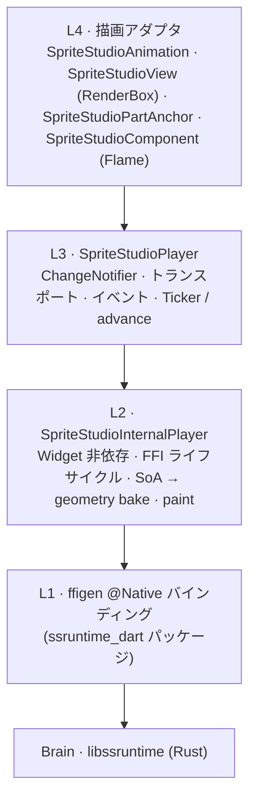

# 🧩 プレイヤーの構成

SpriteStudio Player for Flutter は、SpriteStudio-SDK の **Brain** に対する **Body** です。Brain
（`libssruntime`、Rust `no_std`）が `.ssab` を読み込んで時間を進め、フレームごとの **SoA バッファ**（ワールド行列・ローカル頂点 / UV）と、**`DrawBatch`** プランを載せた FlatBuffers の **`FrameData`**
を出力します。Body はそれを `dart:ffi` で受け取り、差し替え可能なレンダーバックエンド（`Canvas.drawVertices` または `flutter_gpu`（Impeller））でプランを実行します。保持シーングラフは持たず、毎フレーム作り直します。

## 4 レイヤー

**下方向への厳格な依存**で、下のレイヤーほど Brain に近い。各レイヤーの役割は 1 つずつ:

| レイヤー | 役割 | 所在 |
|---|---|---|
| **L4** | 描画アダプタ —— `SpriteStudioAnimation`（プレイヤーと Ticker を自分で持つウィジェット）、`SpriteStudioView`（利用者が持つプレイヤーを描く `RenderBox`）、`SpriteStudioPartAnchor`（パーツに留める子）、`SpriteStudioStateView` / `SpriteStudioHitRegion`（ボタンの中のアニメ。`ui.dart`）、Flame の `SpriteStudioComponent` / `SpriteStudioButtonComponent` | `ssplayer_flutter`, `ssplayer_flame` |
| **L3** | `SpriteStudioPlayer` —— トランスポート / イベント。vsync モードでは `Ticker`、外部クロックでは `advance` | `ssplayer_flutter` |
| **L2** | `SpriteStudioInternalPlayer` —— FFI Context のライフサイクル（`.ssab` の解析は、同じバイト列の Player すべてで 1 つを共有）、SoA → geometry bake（Canvas は `ui.Vertices`、GPU はインターリーブ VBO）、`paint` = `DrawBatch.kind` ディスパッチ | `ssplayer_flutter` |
| **L1** | ffigen `@Native` C-API バインディング + ランタイム FlatBuffers | `ssruntime_dart` |

**L2 は Widget 非依存**に保つことで、ヘッドレス / Flame / どちらのレンダーバックエンド（`Canvas` / `flutter_gpu`）からも再利用できます。

## どこに何があるか

- **L1** —— `ssruntime_dart`（純 Dart・非 Flutter）: 生成した `@Native` C-API バインディングとランタイムの FlatBuffers（`framedata` / `effect_draw_plan`）。ネイティブライブラリはパッケージのビルドフックが同梱。
- **L2–L4** —— `ssplayer_flutter`（公開 API のバレルと、ボタン向けのウィジェットの `ui.dart`。L1 は `ssruntime_dart` から直接 import）。
- **Flame L4** —— `ssplayer_flame`（コアが `flame` を巻き込まないよう別パッケージ）。
- **コンバータ** —— `ssconverter_dart`（ホスト `.sspj` → `.ssab`、デスクトップ専用）。

一覧と役割は [パッケージ](../packages.md) を参照してください。

## 描画モデル

Brain が `DrawBatch` プランを出し、`paint` は `DrawBatch.kind`
（`Normal / Mesh / Effect / Instance / Shape`）で分岐して、各バッチをアクティブな**レンダーバックエンド**に委譲します。Brain はパーツの種類が変わるたびにバッチを切るため、テクスチャと合成が同じ Normal / Mesh のバッチが続く区間はまとめてバックエンドに渡り、素のパーツは 1 回で描画されます（Ringo の 1 フレーム 8 バッチは 1 回の描画）。Effect のバッチが続く区間も同様にまとめて渡り、セルマップと合成が同じパーティクルはエフェクトパーツをまたいで 1 回で描画されます。`Canvas` バックエンドは各バッチ（またはそうしたバッチの連なり）を 1 つの indexed `ui.Vertices`（`Canvas.drawVertices`）に
bake し、`flutter_gpu`（Impeller）バックエンドはインターリーブ VBO を bake して自前のパイプラインでオフスクリーンに描画します。独立したパスを要するパーツ —— PartColor・統合シェーダ・マルチパスの
Sub / Invert 合成 —— は、`Canvas` ではバッチから切り出して個別に描画し、`flutter_gpu` バックエンドではまとめて描画します。バックエンドは `SpriteStudioBackend` に応じて選択されます（`auto` は capability
プローブが通れば flutter_gpu、通らなければ Canvas）。毎フレーム作り直すため、性能のレバーは**毎フレームのアロケーション** と **ドローコール数** です。

## この作りになっている理由

ここに挙げる理由はどれも複数のファイルにまたがります。詳細は、関わるコードのコメントにあります。

**パーツの姿勢は、行列のまま追従先に届きます。** `SpriteStudioPartAnchor` は `partTransform` を `Matrix4` のまま `Transform` に渡すので、反転（パーツや祖先の負のスケール）も失われずに届きます。Unity と Godot のプレイヤーは姿勢を `Quaternion` / `Transform2D` に分解します。反転した行列では `Matrix4x4.rotation` が定まらず、左右の反転は取り出した回転に余分な 180° を残します。ここで行列を分解するコードはその注意点を引き受けるので、先に `determinant()` を確かめます。

**`cancel` は、ここでは厳密で、兄弟の Player では近似です。** プレイヤーを反転したときに子を反転させないのは、プレイヤーを反転するときにこのライブラリ自身が掛けた ±1 の対角を打ち消す処理なので、回転は残りません。Unity と Godot のプレイヤーでスケールを追わない設定（`driveScale` / `update_scale` を off）にした同等のものは、左右の反転で 180° が残ります。

**`flutter_gpu` では、プレイヤーごとに自分のオフスクリーンへ描いてから合成します。** そのため、アプリが下の `Canvas` に描いたものは、プレイヤーのブレンドが読む描画先になりません。描画先になるのは同じアニメのほかのパーツです。GPU バックエンドのブレンドの確認で、塗った背景の上ではなく、同じアニメのほかのパーツの上で対象パーツを表示・非表示にして比べるのはこのためです。

## さらに詳しく

ネイティブライブラリの解決と同梱は [ネイティブランタイム](native-runtime.md)、チェックアウトからのビルドとテストは [ビルドガイド](build.md) にあります。
