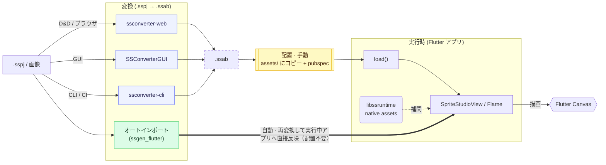

# 🔄 アセットの準備（`.sspj` → `.ssab`）

プレイヤーが再生するのはエディタの `.sspj` ではなく、**`.ssab`**（パース不要のランタイムバイナリ）
です。コンバータが `.sspj` と参照ファイル（`.ssae` / `.ssee` / `.ssqe` / `.ssce`）を読み、`.ssab`
（アニメーション）と、必要に応じて `.ssqb`（シーケンスパック）を生成します。変換は**ビルド時**に行い、
アプリは完成した `.ssab` を読み込むだけです。



**手動の配置が要らないのはオートインポートだけです。** `ssgen_flutter` がソースを監視し、保存の
たびに再変換して、できたての `.ssab` を実行中アプリへ直接プッシュします —— 手動ステップはありません。
ブラウザ・GUI・CLI の 3 経路は `.ssab` ファイルを手元に出力するだけなので、その後に**配置**が必要です
——アプリの `assets/` にコピーし、`pubspec.yaml` に登録します（[`.ssab` を配置する](#ssab)を参照）。

## 参照テクスチャ形式 vs embedded

**最初に**これを決めます —— 以下のどのルートでも、`.ssab` はどちらの形式でも出力できます。

| 形式 | フラグ | 生成物 | 使いどころ |
|---|---|---|---|
| **参照** | *(既定)* | 同じフォルダの PNG / WebP を参照する `.ssab` | ローカルでの反復、テクスチャの共有 |
| **embedded** | `-e` / `--embedded` | テクスチャを内包した自己完結の `.ssab` | 配布 —— アニメ 1 本 = 1 ファイル |

どちらの形式も読み込み方は同じです。`loadAsset('…/Foo.ssab')` が reference の画像をキー自身の
フォルダから解決し、embedded は自身に内包します。[クイックスタート](quickstart.md) を参照。

## 変換ルートを選ぶ

Flutter には Godot / Unity プラグインのようなエディタ内「インポートドック」がないため、変換は独立した
ステップになります。コンバータはオープンソースで、オートインポータ・ブラウザツール・デスクトップ
GUI・CLI といった形で提供され、いずれも同じ `.ssab` を生成します —— 作業スタイルに合うルートを
選んでください。

| ルート | 向いている用途 | 入手方法 |
|---|---|---|
| [**オートインポート（ライブリロード）**](#_2) | 開発中の反復 —— 保存で自動変換、手動ステップなし | 標準搭載: [`ssgen_flutter`](live-reload.md) |
| [**ssconverter-web**](#ssconverter-web) | ブラウザで単発、インストール不要 | 🚧 未公開（Chromium 専用） |
| [**SSConverterGUI**](#ssconvertergui-gui) | シンプルなデスクトップ GUI —— ドラッグ&ドロップ・バッチ・embedded 切替 | [バイナリをダウンロード](https://github.com/cri-middleware/SSConverterGUI/releases) |
| [**ssconverter-cli**](#ssconverter-cli) | CI / ビルド時 / 再現性 —— ワークスペース同梱の Dart 製 `ssconvert` を含む | [SDK Releases](https://github.com/cri-middleware/SpriteStudio-SDK/releases) · `dart run ssconverter_dart:ssconvert` |

!!! tip "Flutter プロジェクトは追加インストールがほぼ不要"
    このリポジトリはコンバータを Dart パッケージとして同梱しているので、`dart run
    ssconverter_dart:ssconvert`（[ssconverter-cli](#ssconverter-cli) 参照）が追加インストールなしで
    変換し、ネイティブライブラリも自動ダウンロードします。オートインポータ・ブラウザツール・
    デスクトップ GUI は、ライブループ／ブラウザ／ターミナル不要の作業が合う場面のための選択肢です。

## オートインポート（ライブリロード）

開発中に最も摩擦の少ないルート。SpriteStudio 7 で保存すると実行中のアプリが自動で再変換・更新します
—— 手動変換も**配置も一切不要**です（できたてのパックが実行中アプリへ直接プッシュされます）。Godot /
Unity のインポータの高速反復ループに相当し、`ssgen_flutter` が提供します。[ライブリロード](live-reload.md)
を参照。

## ssconverter-web（ブラウザ）

ブラウザで `.sspj` を変換して結果をダウンロード —— インストール不要。コンバータの WebAssembly ビルドを
クライアント側で実行します。その後、ダウンロードした `.ssab` を[配置](#ssab)します。

!!! note "🚧 未公開"
    公開後は GitHub Pages でホストされます
    （<https://cri-middleware.github.io/SSPlayerForWeb/ssconverter/>）。フォルダ選択に **File System
    Access API** を使うため、**Chromium 系ブラウザ（Chrome / Edge）**が必要です。

## SSConverterGUI（デスクトップ GUI）

シンプルなクロスプラットフォームのデスクトップ GUI。プロジェクトをドラッグ&ドロップ、バッチ変換、
embedded 出力の切替ができます。OS 向けバイナリを
[**SSConverterGUI Releases**](https://github.com/cri-middleware/SSConverterGUI/releases)
からダウンロードして実行します。ターミナルを触りたくないときに。その後、変換した `.ssab` を
[配置](#ssab)します。

## ssconverter-cli

`libssconverter` をラップするネイティブのビルド時 CLI。等価なフロントエンドが 2 つあり、どちらも
同じ `.ssab` を生成します。

### Flutter / Dart —— `dart run ssconverter_dart:ssconvert`（推奨・ワークスペース同梱）

このリポジトリはコンバータを
[`ssconverter_dart`](https://github.com/cri-middleware/SSPlayerForFlutter/tree/main/packages/ssconverter_dart)
パッケージとして同梱し、`ssconvert` CLI と `SsConverter` ライブラリを提供します。ネイティブ
`libssconverter` はパッケージのビルドフックが自動ダウンロードするので、そのまま動きます ——
**Rust ツールチェーン不要・別バイナリ不要**。**デスクトップ専用**のホストツールです
（macOS / Windows / Linux）。

```bash
dart run ssconverter_dart:ssconvert    -o out/     path/to/project.sspj  # 参照テクスチャ形式
dart run ssconverter_dart:ssconvert -e -o out_emb/ path/to/project.sspj  # embedded（配布向け）
```

素の `dart run` なので、追加バイナリなしで任意の Dart/Flutter CI に組み込めます。ビルドの一部として
アプリの `assets/` に直接変換 —— example アプリで
[`scripts/deploy-examples.sh`](https://github.com/cri-middleware/SSPlayerForFlutter/blob/main/scripts/deploy-examples.sh)
がやっているのがまさにこれです。同じエンジンは `SsConverter`（`package:ssconverter_dart`）として
プログラムからも使え、Dart 製の独自ツールに組み込めます。

!!! tip "`.sspj` ソースは出荷アプリの外へ"
    SpriteStudio のソースプロジェクトは Flutter パッケージ（やリポジトリ）の外で管理し、変換済みの
    `.ssab` だけをコミットしましょう。ゲームにソースデータは不要です。

### SDK —— `ssconverter-cli`（言語非依存）

SpriteStudio-SDK が配布するスタンドアロンのネイティブ CLI（同じ `libssconverter`）。言語非依存の CI、
非 Dart パイプライン、Dart ツールチェーンに依存しない再現性が必要な場面に向きます。

- **プリビルドバイナリ** —— Windows / macOS / Linux ビルドを
  [**SpriteStudio-SDK Releases**](https://github.com/cri-middleware/SpriteStudio-SDK/releases) から。
- **ソースからビルド** —— Rust ツールチェーンで、SDK リポジトリルートで `cargo install --path cli`。

```bash
ssconverter-cli project.sspj -o ./assets      # 出力ディレクトリ指定で変換
ssconverter-cli project.sspj --embedded       # テクスチャを .ssab に内包
```

詳細オプションは SDK の
[`ssconverter-cli` README](https://github.com/cri-middleware/SpriteStudio-SDK/blob/main/cli/README.md)
を参照。

## `.ssab` を配置する（手動ルート）

ブラウザ・GUI・CLI の各ルートは `.ssab` をファイルとして出力するだけなので、アプリ側で同梱が必要です
（オートインポートはこれを自動で行います）。

1. `.ssab` をアプリのアセットにコピーします（例: `assets/spritestudio/<name>/`）。**参照形式**の出力なら
   同じフォルダのテクスチャも一緒に、**embedded** なら 1 ファイルだけです。
2. フォルダを `pubspec.yaml` に登録します。
   ```yaml
   flutter:
     assets:
       - assets/spritestudio/
   ```
3. `loadAsset('assets/spritestudio/…/Foo.ssab')` で読み込みます —— reference テクスチャはキー
   自身のフォルダから解決されます。[クイックスタート](quickstart.md) を参照。

CI では手順 1 をビルドの一部としてスクリプト化します —— example アプリの
[`scripts/deploy-examples.sh`](https://github.com/cri-middleware/SSPlayerForFlutter/blob/main/scripts/deploy-examples.sh)
がまさにこれ（`assets/` へ直接変換）です。
