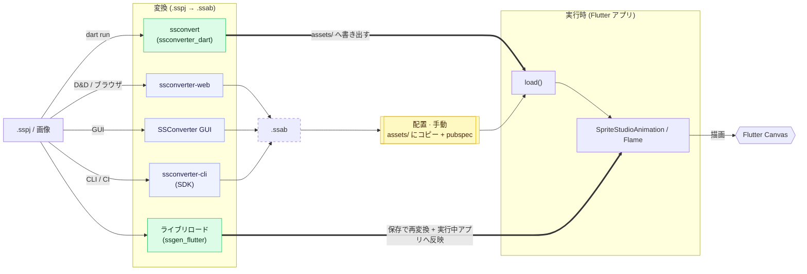

# 🔄 アセットの準備（`.sspj` → `.ssab`）

プレイヤーが再生するのはエディタの `.sspj` ではなく、**`.ssab`**（パース不要のランタイムバイナリ）です。コンバータが `.sspj` と参照ファイル（`.ssae` / `.ssee` / `.ssqe` / `.ssce`）を読み、`.ssab`
（アニメーション）と、必要に応じて `.ssqb`（シーケンスパック）を生成します。変換は**アプリの実行より前に**、手元や CI で行い、アプリは完成した `.ssab` を読み込むだけです。



**既定の手順は `ssconvert` で、[クイックスタート](quickstart.md)もこれを使います。** `ssconverter_dart` を dev 依存に入れれば、`SpriteStudio_Source/` のプロジェクトを 1 つのコマンドでアプリの `assets/` へ直接変換でき、[ライブリロード](live-reload.md)はアプリの実行中に同じ `SpriteStudio_Source/` を保存のたびに再変換します。ブラウザ・GUI・SDK の CLI はファイルを出力するので、自分で[配置](#ssab-を配置するほかのルート)します。

> [!NOTE] どのファイルが、変換後のどれになるのか
> `.sspj` / `.ssae` / `.ssce` / `.ssqe` それぞれの役割と変換後の対応は Player 共通なので、ポータルにまとめてあります — [アセットの変換 — プロジェクトの構成と、変換後の対応](https://cri-middleware.github.io/SpriteStudio-Docs/ja/overview/conversion/#プロジェクトの構成と変換後の対応)。
>
> 要点は 2 つです。**`.ssae` 1 本が `.ssab` 1 本**になること、そして**セルの切り出し位置は `.ssce` から `.ssab` へ焼き込まれる**こと。後者があるため、セルを追加・移動・リサイズしたり画像サイズを変えたりしたときは、**画像だけでなく `.ssab` も作り直して一緒に配置**してください。画像だけを差し替えると、古い切り出し位置のまま描画されて絵がずれます（embedded で出力していれば `.ssab` 1 つの差し替えで済みます）。

## 参照テクスチャ形式 vs embedded

**最初に**これを決めます —— 以下のどのルートでも、`.ssab` はどちらの形式でも出力できます。

| 形式 | フラグ | 生成物 | 使いどころ |
|---|---|---|---|
| **参照** | *(既定)* | 同じフォルダの PNG / WebP を参照する `.ssab` | ローカルでの反復、テクスチャの共有 |
| **embedded** | `-e` / `--embedded` | テクスチャを内包した自己完結の `.ssab` | 配布 —— アニメ 1 本 = 1 ファイル |

どちらの形式も読み込み方は同じです。`loadAsset('…/Foo.ssab')` が reference の画像をキー自身のフォルダから解決し、embedded は自身に内包します。[クイックスタート](quickstart.md) を参照。

## 変換ルートを選ぶ

以下のルートはどれも同じオープンソースのコンバータを使い、同じ `.ssab` を生成します。

> [!TIP] 手元に `.sspj` がまだ無いときは
> [SpriteStudio 公式のサンプルデータ](https://www.webtech.co.jp/help/ja/spritestudio7/download/sample/)がそのまま使えます。キャラクターなら [Ringo](https://www.webtech.co.jp/help/ja/spritestudio7/download/sample/#ringo)、エフェクトを含むものなら
> [パーティクル](https://www.webtech.co.jp/help/ja/spritestudio7/download/sample/#Perticle_sample) が手頃です。ダウンロードした `.sspj` は、以下のどのルートにもそのまま渡せます。

| ルート | 向いている用途 | 入手方法 |
|---|---|---|
| [**ssconvert**](#ssconvertdart) | 既定の手順 —— `SpriteStudio_Source/` を `assets/` へ変換。手元でも CI でも | `flutter pub add --dev ssconverter_dart` |
| [**ライブリロード**](#ライブリロード) | アプリの実行中に、同じ `SpriteStudio_Source/` から保存のたびに再変換 | `flutter pub add --dev ssgen_flutter`（[ライブリロード](live-reload.md)） |
| [**ssconverter-web**](#ssconverter-webブラウザ) | ブラウザで単発、インストール不要 | [ブラウザで開く](https://cri-middleware.github.io/SSPlayerForWeb/ssconverter/) |
| [**SSConverter GUI**](#ssconverter-guiデスクトップ-gui) | デスクトップ GUI（macOS・Windows）—— ドラッグ&ドロップ・バッチ・embedded 切替 | [バイナリをダウンロード](https://github.com/cri-middleware/SSConverterGUI/releases) |
| [**ssconverter-cli**](#ssconverter-clisdk) | Dart 以外のパイプライン | [SDK Releases](https://github.com/cri-middleware/SpriteStudio-SDK/releases) |

## ssconvert（Dart）

[`ssconverter_dart`](https://github.com/cri-middleware/SSPlayerForFlutter/tree/main/packages/ssconverter_dart) は [インストール](install.md)のとおり dev 依存として追加するパッケージで、`ssconvert` CLI と `SsConverter` ライブラリを提供します。ネイティブ `libssconverter` はパッケージのビルドフックがダウンロードするので、**Rust ツールチェーンも別バイナリも不要**です。**デスクトップ専用**のホストツールです（macOS / Windows / Linux）。アセットへ直接変換します。

```bash
dart run ssconverter_dart:ssconvert    -o assets/spritestudio/Ringo/     SpriteStudio_Source/Ringo/Ringo.sspj  # 参照テクスチャ形式
dart run ssconverter_dart:ssconvert -e -o assets/spritestudio/Ringo_emb/ SpriteStudio_Source/Ringo/Ringo.sspj  # embedded（配布向け）
```

そのあとフォルダを `pubspec.yaml` に登録します（[`.ssab` を配置する](#ssab-を配置するほかのルート)の手順 2）。素の `dart run` なので、任意の Dart/Flutter CI に組み込めます。同じエンジンは `SsConverter`（`package:ssconverter_dart`）としてプログラムからも使え、Dart 製の独自ツールに組み込めます。

> [!TIP] ソースはアプリに入らない
> アプリに同梱されるのは `flutter: assets:` に並べたフォルダだけなので、`SpriteStudio_Source/` はアプリに入りません。

## ライブリロード

SpriteStudio で保存すると、実行中のアプリが再変換して更新します。`ssgen_flutter` が同じ `SpriteStudio_Source/` を監視し、`assets/spritestudio/` に書き出して、できたてのパックを実行中のアプリへプッシュします。[ライブリロード](live-reload.md)を参照。

## ssconverter-web（ブラウザ）

ブラウザで `.sspj` を変換して結果をダウンロード —— インストール不要。コンバータの WebAssembly ビルドをクライアント側で実行し、ZIP には `.sspj` の名前のフォルダが 1 つ入っています。その後、[配置](#ssab-を配置するほかのルート)します。

> [!NOTE] フォルダのドロップには Chromium 系ブラウザが必要
> GitHub Pages でホストしています（<https://cri-middleware.github.io/SSPlayerForWeb/ssconverter/>）。フォルダのドロップには **File System Access API** を使うため、**Chromium 系ブラウザ**（Chrome / Edge）が必要です。ほかのブラウザでは **Browse...** でフォルダを選択してください。

## SSConverter GUI（デスクトップ GUI）

macOS と Windows 向けのシンプルなデスクトップ GUI です（Linux では `ssconvert` か `ssconverter-cli` を使います）。プロジェクトをドラッグ&ドロップ、バッチ変換、embedded 出力の切替ができます。OS 向けのアーカイブを [**SSConverter GUI Releases**](https://github.com/cri-middleware/SSConverterGUI/releases) からダウンロードし、展開して実行します。その後、変換した `.ssab` を[配置](#ssab-を配置するほかのルート)します。

## ssconverter-cli（SDK）

SpriteStudio-SDK が配布するスタンドアロンのネイティブ CLI（同じ `libssconverter`）。Dart 以外のパイプラインに向きます。

[**SpriteStudio-SDK の Release**](https://github.com/cri-middleware/SpriteStudio-SDK/releases) の **Assets** から、`ssconverter-cli-macos.zip`・`ssconverter-cli-windows.zip`（ARM64 は `ssconverter-cli-windows-arm64.zip`）・`ssconverter-cli-linux.zip`（ARM64 は `ssconverter-cli-linux-aarch64.zip`）のいずれかをダウンロードして展開します。以下のコマンドをそのまま使うには、中の `ssconverter-cli` を `PATH` に置きます。

```bash
ssconverter-cli project.sspj -o ./assets      # 出力ディレクトリ指定で変換
ssconverter-cli project.sspj --embedded       # テクスチャを .ssab に内包
```

詳細オプションは SDK の [`ssconverter-cli` README](https://github.com/cri-middleware/SpriteStudio-SDK/blob/HEAD/cli/README.ja.md) を参照。

## `.ssab` を配置する（ほかのルート）

`ssconvert` とライブリロードは自分で `assets/` に書き出します。ブラウザ・GUI・SDK の CLI は手元にファイルを出力するので、自分で配置します。

1. 出力をアプリのアセットにコピーします（例: `assets/spritestudio/<name>/`）。**参照形式**の出力なら同じフォルダのテクスチャも一緒に、**embedded** なら 1 ファイルだけです。
2. フォルダを `pubspec.yaml` に登録します。登録はフォルダごとに 1 行です。Flutter のアセットの登録はサブフォルダを含まないので、コンバータが `.ssab` の隣に書き出す `font/` や `sound/` のフォルダにも、それぞれ 1 行要ります。
   ```yaml
   flutter:
     assets:
       - assets/spritestudio/<name>/
   ```
3. `loadAsset('assets/spritestudio/…/Foo.ssab')` で読み込みます —— reference テクスチャはキー自身のフォルダから解決されます。[クイックスタート](quickstart.md) を参照。
