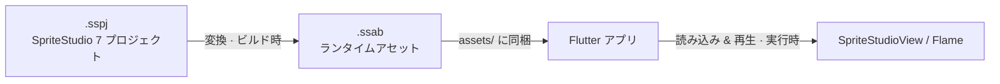

# アセットの準備（`.sspj` → `.ssab`）

プレイヤーが再生するのはエディタの `.sspj` ではなく、**`.ssab`**（パース不要のランタイムバイナリ）
です。コンバータが `.sspj` と参照ファイル（`.ssae` / `.ssee` / `.ssqe` / `.ssce`）を読み、`.ssab`
（アニメーション）と、必要に応じて `.ssqb`（シーケンスパック）を生成します。変換は**ビルド時**に行い、
アプリは完成した `.ssab` を読み込むだけです。



## 変換ルートを選ぶ

Flutter には Godot / Unity プラグインのようなエディタ内「インポートドック」がないため、変換は独立した
ステップになります。コンバータはオープンソースで、CLI・デスクトップ GUI・ブラウザツール・組み込み
ライブラリといった形で提供されます —— 作業スタイルに合うルートを選んでください。Flutter ネイティブの
`ssconvert` が推奨の既定です（既にワークスペースに入っています）。

| ルート | 向いている用途 | 入手方法 |
|---|---|---|
| **オートインポート（ライブリロード）** | 開発中の反復 —— 保存で自動変換、手動ステップなし | 標準搭載: [`ssgen_flutter`](live-reload.md) |
| **`ssconvert`** *(推奨)* | CI / ビルド時 / 再現性、インストール不要 | `dart run ssconverter_dart:ssconvert` |
| **SSConverterGUI** | シンプルなデスクトップ GUI —— ドラッグ&ドロップ・バッチ・embedded 切替 | [バイナリをダウンロード](https://github.com/cri-middleware/SSConverterGUI/releases) |
| **ssconverter-web** | ブラウザで単発、インストール不要 | 🚧 未公開（Chromium 専用） |
| **ssconverter-cli** | 言語非依存の CI / 非 Dart パイプライン | [SDK Releases](https://github.com/cri-middleware/SpriteStudio-SDK/releases)、または `cargo install` |

!!! tip "別バイナリはほとんど不要"
    `ssconvert` はこのワークスペースに同梱され、ネイティブコンバータを自動ダウンロードするので、
    多くの Flutter プロジェクトは追加インストール不要です。SSConverterGUI・ssconverter-web・SDK の
    `ssconverter-cli` は、GUI／ブラウザ／非 Dart パイプラインが合う場面のための選択肢で、いずれも
    同じ `.ssab` を生成します。

## `ssconvert`（`ssconverter_dart`）—— 推奨

[`ssconverter_dart`](https://github.com/cri-middleware/SSPlayerForFlutter/tree/main/packages/ssconverter_dart)
パッケージが提供する、Dart だけで完結する変換です。`ssconvert` CLI と `SsConverter` ライブラリを
同梱します。ネイティブ `libssconverter` はパッケージのビルドフックが自動ダウンロードするので、
そのまま動きます —— **Rust ツールチェーン不要・別バイナリ不要**。**デスクトップ専用**のホストツール
です（macOS / Windows / Linux）。

```bash
dart run ssconverter_dart:ssconvert    -o out/     path/to/project.sspj  # 参照テクスチャ形式
dart run ssconverter_dart:ssconvert -e -o out_emb/ path/to/project.sspj  # embedded（配布向け）
```

### 参照テクスチャ形式 vs embedded

| 形式 | フラグ | 生成物 | 使いどころ |
|---|---|---|---|
| **参照** | *(既定)* | 兄弟 PNG / WebP を参照する `.ssab` | ローカルでの反復、テクスチャの共有 |
| **embedded** | `-e` | テクスチャを内包した自己完結の `.ssab` | 配布 —— アニメ 1 本 = 1 ファイル |

参照形式の `.ssab` は `baseAssetDir` を渡して兄弟画像を解決します。embedded なら不要です。
[クイックスタート](quickstart.md) を参照。

### ビルド / CI パイプラインで

素の `dart run` なので、追加バイナリなしで任意の Dart/Flutter CI に組み込めます。ビルドの一部として
アプリの `assets/` に直接変換 —— example アプリで
[`scripts/deploy-examples.sh`](https://github.com/cri-middleware/SSPlayerForFlutter/blob/main/scripts/deploy-examples.sh)
がやっているのがまさにこれです。同じエンジンは `SsConverter`（`package:ssconverter_dart`）として
プログラムからも使え、Dart 製の独自ツールに組み込めます。

!!! tip "`.sspj` ソースは出荷アプリの外へ"
    SpriteStudio のソースプロジェクトは Flutter パッケージ（やリポジトリ）の外で管理し、変換済みの
    `.ssab` だけをコミットしましょう。ゲームにソースデータは不要です。

## オートインポート（ライブリロード）

開発中に最も摩擦の少ないルート。SpriteStudio 7 で保存すると実行中のアプリが自動で再変換・更新します
—— 手動変換は一切不要です。Godot / Unity のインポータの高速反復ループに相当し、`ssgen_flutter` が
提供します。[ライブリロード](live-reload.md) を参照。

## SSConverterGUI（デスクトップ GUI）

シンプルなクロスプラットフォームのデスクトップ GUI。プロジェクトをドラッグ&ドロップ、バッチ変換、
embedded 出力の切替ができます。OS 向けバイナリを
[**SSConverterGUI Releases**](https://github.com/cri-middleware/SSConverterGUI/releases)
からダウンロードして実行します。ターミナルを触りたくないときに。

## ssconverter-web（ブラウザ）

ブラウザで `.sspj` を変換して結果をダウンロード —— インストール不要。コンバータの WebAssembly ビルドを
クライアント側で実行します。

!!! note "🚧 未公開"
    公開後は GitHub Pages でホストされます
    （<https://cri-middleware.github.io/SSPlayerForWeb/ssconverter/>）。フォルダ選択に **File System
    Access API** を使うため、**Chromium 系ブラウザ（Chrome / Edge）**が必要です。

## ssconverter-cli（SDK）

SpriteStudio-SDK が配布するネイティブのビルド時 CLI（同じ `libssconverter` のラッパ）。言語非依存の
CI、非 Dart パイプライン、Dart ツールチェーンに依存しない再現性が必要な場面に向きます。

- **プリビルドバイナリ** —— Windows / macOS / Linux ビルドを
  [**SpriteStudio-SDK Releases**](https://github.com/cri-middleware/SpriteStudio-SDK/releases) から。
- **ソースからビルド** —— Rust ツールチェーンで、SDK リポジトリルートで `cargo install --path cli`。

```bash
ssconverter-cli project.sspj -o ./assets      # 出力ディレクトリ指定で変換
ssconverter-cli project.sspj --embedded       # テクスチャを .ssab に内包
```

詳細オプションは SDK の
[`ssconverter-cli` README](https://github.com/cri-middleware/SpriteStudio-SDK/blob/main/cli/README.md)
を参照。
