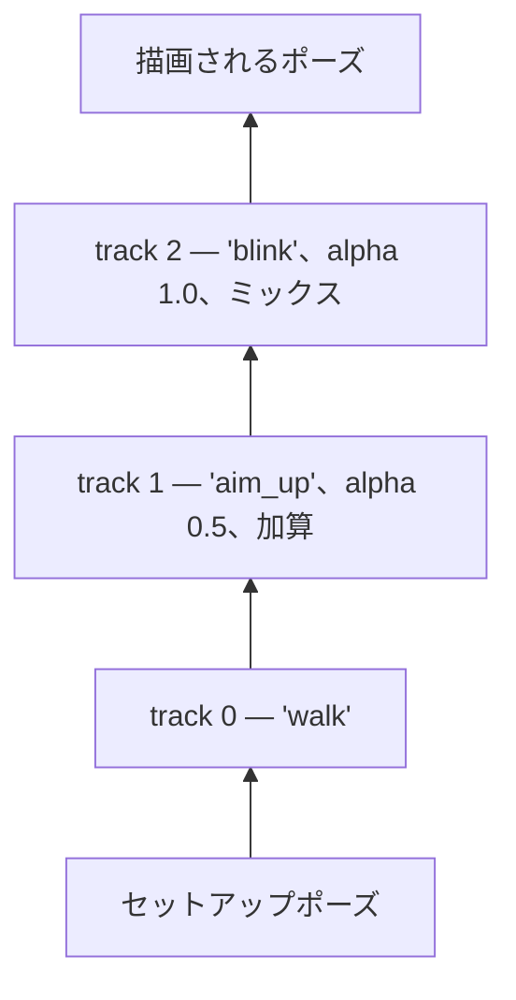

# 🎚️ モーションブレンド

1 体のキャラクターで複数のアニメを同時に再生し、カットせずにつなぎます。下で歩き、その上に狙いのポーズを重ね、単発のリアクションをクロスフェードで入れる —— アニメーターが別々に作ったアニメから、そうした動きを組み立てられます。

ここで使う呼び出しはどれもパックが要るので、`SpriteStudioAnimation` では `onLoaded` で呼んでください。

## トラックを積み重ねる { #tracks }

トラックは**セットアップポーズ**（アニメーションデータが定める基準のポーズ）の上に、番号の小さい順に重なります。各トラックはアニメを 1 つ再生し、**alpha**（下のポーズにどれだけ残るか）と**ブレンド**を持ちます。



**track 0 はキャラクターそのものです。** `setAnimation` で選んだアニメを再生し、プレイヤーが報告するのもこのトラックです。`currentAnimation`、`isFinished`、フレームの読み出し、イベントはどれも track 0 に従います。その上のトラックはオーバーレイです。

| ブレンド | 働き |
|---|---|
| `SsTrackBlend.mix` | トラックのポーズへ線形補間します。alpha 1 ならトラックがそのまま勝ちます |
| `SsTrackBlend.additive` | トラックの**セットアップポーズからの差分**を足すので、下の動きが透けて見えます。狙い・傾き・呼吸のためのブレンドです |

## オーバーレイを重ねる

```dart
_player.setAnimation('walk');        // track 0
_player.play();

_player.setTrackAnimation(1, 'aim_up');               // オーバーレイ
_player.setTrackBlend(1, SsTrackBlend.additive);
_player.setTrackAlpha(1, 0.5);                        // 半分の強さ

// ……外すとき
_player.clearTrack(1);
```

`clearTrack` は track 0 を断ります。代わりに alpha 0 へフェードすると、キャラクターがセットアップポーズに落ち着きます。

トラック系の呼び出しは、`load` の前、またはランタイムが断ったときに `false`（読み取りなら `null`）を返します。`setTrackAlpha`・`setTrackBlend`・`fadeTrack` は存在しないトラックにも `false` を返すので、先にアニメを載せてください。アニメを載せる呼び出し（`setTrackAnimation`・`crossfade`・`addTrackSource`）とトラックごとの設定は、トラックを作ります。例外は投げません。ランタイムが断ったときは、呼び出し・トラックかソース・渡したアニメ名・ランタイムの理由をログにも 1 回だけ出すので、名前を打ち間違えても前のアニメが黙って再生され続けることはありません。

!!! warning "`setAnimation` はスタックをたたみます"
    `setAnimation` で track 0 を切り替えると、オーバーレイ・フェード・[ソース](#sources)はすべて消え、各トラックの alpha・ブレンド・同期も戻ります。切り替えた後で重ね直すか、それらを残す[クロスフェード](#crossfade)で切り替えてください。

## カットせずフェードでつなぐ { #crossfade }

どちらのフェードもプレイヤーの時計で進みます。始めたら、あとは再生を続けるだけです。

```dart
// トラックの再生アニメを、今の位置から 400 ms かけて差し替える。
_player.crossfade(0, 'run', const Duration(milliseconds: 400));

// トラックの alpha を 250 ms かけて動かす。
_player.fadeTrack(1, 0.0, const Duration(milliseconds: 250)); // オーバーレイを消す
_player.fadeTrack(0, 0.0, const Duration(milliseconds: 600)); // セットアップポーズに落ち着かせる

final t = _player.trackFadeProgress(0); // 0..1、フェードしていなければ null
_player.cancelTrackFade(1);
```

### track 0 のクロスフェードで何が、いつ替わるか

入ってくるアニメが track 0 を引き継ぐのは、フェードの完了時ではなく**開始時**です。

* 呼んだ直後から `currentAnimation` が入ってくる側の名前になります。そのため、フェードで出ていった側の名前で `setAnimation` を呼ぶと、何もしないのではなく元に戻ります。`canvasSize` もこれに従います。
* セル・表示・その他ブレンドできない値は、フェードの最初のフレームから入ってくる側のものになります。`isFinished` と `onAnimationFinished` が報告するのも入ってくる側の状態です。出ていく側がフェード中に終わっても、プレイヤーは終了になりません。
* イベントは入ってくる側が最初から発火し、出ていく側は発火しなくなります（[イベント](#events)参照）。
* 入ってくる側は、設定した速度・フレームレート・フレームスキップ・再生方向・`loopCount` で再生されます。`setAnimation` で切り替えたときと同じです。再生区間はそのアニメの全体になります。
* `setAnimation` と違って、巻き戻しも停止もしません。時計は動き続け、ほかのトラックもそのままです。`onAnimationStarted` も発火しません。

トラックが再生していたものは、比率を保ったまままとめてフェードアウトします。フェード中にもう一度 `crossfade` を呼んでも、進行中のフェードをその時点の状態のまま引き取るので、ポーズは飛びません。`cancelTrackFade` の後や、複数のアニメを混ぜているトラックからのクロスフェードでも同じです。

!!! note "インスタンスとエフェクトのパーツは動き続けます"
    クロスフェードは切り替えではなくフェードなので、インスタンスの子とエフェクトは、入ってくる側のアニメの下でそのまま動き続けます。引き継いだ後にどのキーで動くかは、モーションブレンドの対象外です（[制限](#limits)参照）。

### `SpriteStudioAnimation` では

このウィジェットは `animation` パラメータで track 0 を切り替えます。`transition` を与えると、`animation` を変えたときに切り替えではなくクロスフェードになります。

```dart
SpriteStudioAnimation.asset(
  'assets/spritestudio/Hero/Hero.ssab',
  animation: _running ? 'run' : 'walk',
  transition: const Duration(milliseconds: 200),
)
```

ウィジェットの下で track 0 を切り替えるときは、プレイヤーの `crossfade(0, …)` を呼ばず、これらのパラメータで行ってください。パラメータが古いアニメの名前のまま残り、その名前に戻そうとしても「変わっていない」と見なされてしまいます。track 1 以降はプレイヤーで操作してかまいません。

## 1 つのトラックに複数のアニメ { #sources }

1 つのトラックに複数のアニメを載せ、**weight** で混ぜられます。歩きと走りを、キャラクターの速さに合わせて混ぜるような使い方です。それぞれを*ソース*と呼び、ハンドルで指します。

```dart
_player.setAnimation('walk');
_player.play();
final walk = _player.trackMainSource(0)!;
final run = _player.addTrackSource(0, 'run', 0.0)!; // 歩きの横に、今は無音で

// 毎フレーム、キャラクターの速さから
final t = (speed / runSpeed).clamp(0.0, 1.0);
_player.setSourceWeight(walk, 1.0 - t);
_player.setSourceWeight(run, t);
```

* weight は**トラックの中での比率**です。0.7 / 0.3 と 7 / 3 は同じ混ざり方になります。トラックの強さは、あくまでトラックの alpha です。
* 長さの違う歩きと走りは、だんだんずれていきます。トラックの同期を `SsTrackSync.start`（下記）にしてから走りを載せると、揃った位置から始まります。`setSourceFrame` で位置を合わせることもできます。
* ハンドルは、そのソースが解放されるまで有効です（クロスフェードの完了、そのトラックへの `setTrackAnimation` や `clearTrack`、`setAnimation`）。解放後は番号が使い回されるので、それ以降は持ち続けないでください。

## track 0 と揃えて始める { #sync }

トラックに載せたアニメは、再生区間の先頭から始まります。そのため、ストライドの途中にいる歩きの上に走りを載せると、足の位置が合いません。トラックの**同期**を `SsTrackSync.start` にすると、次に載せるアニメは track 0 の**位相**（再生区間のどこまで進んだかの割合）から始まり、長さの違うアニメでも割合で揃います。

```dart
_player.setTrackSync(0, SsTrackSync.start); // 載せる前に
_player.crossfade(0, 'run', const Duration(milliseconds: 400)); // 走りが歩きの位相から始まる
```

| 同期 | 載せたアニメが始まる位置 | 向いている用途 |
|---|---|---|
| `SsTrackSync.free`（既定） | 再生区間の先頭 | 単発の動き：まばたき、口の形、被弾のリアクション |
| `SsTrackSync.start` | track 0 のアニメと同じ割合の位置 | 周期的な動き同士：歩きと走り |

* その後でトラックに載せるすべてに効きます（`setTrackAnimation`、`crossfade`、`addTrackSource`）。track 0 も同じで、入ってくる側が出ていく側の位相から始まります。
* 揃えるのは載せたときの**1 回だけ**です。その後は同じ時計で進むので、長さと速度が同じなら揃ったまま、違えばまたずれていきます。
* alpha やブレンドと同じくトラックの設定なので、`setAnimation` で戻ります。

## トラックの再生設定

速度・フレームレートの上書き・フレームスキップ・再生方向は、アニメではなく**トラック**の設定です。そのトラックに載っているすべてのアニメ（クロスフェードの両側を含む）と、後から載せるすべてのアニメに効きます。

```dart
_player.setTrackSpeed(1, 0.5);
_player.setTrackFrameRate(1, 24);
_player.setTrackFrameSkipEnabled(1, false);
_player.setTrackPlaybackDirection(
    1, SsPlaybackDirection.forward, SsPlaybackStyle.pingPong);
```

track 0 の設定は、これまでのトランスポートそのものです。`speedScale` は track 0 の `setTrackSpeed`、`frameRate` は track 0 の `setTrackFrameRate` にあたり、どちらから書いても値は揃います。

**ループ回数**はトラックではなくアニメの設定です。アニメを載せると無限ループから始まるので、載せた後で回数を指定し、トラックの終了を見てください。track 0 のループ回数は `loopCount` で、`setTrackLoopCount(0, …)` もこれを書き換えます。プレイヤーは track 0 が切り替わるたびに、この回数をかけ直します。

```dart
_player.setTrackAnimation(2, 'hit_react');
_player.setTrackLoopCount(2, 1); // 1 回再生して、最後のフレームで止まる

// 毎フレーム
if (_player.isTrackFinished(2)) {
  // 終わったトラックは、何かするまで最後のフレームのまま
  _player.fadeTrack(2, 0.0, const Duration(milliseconds: 120));
}
```

`trackJustLooped(track)` は、track 0 の `justLooped` と同じく 1 回の進行ごとのパルスです。track 1 以降の終了やループにはコールバックがありません。`onAnimationFinished` を発火し、キャラクターの再生を終わらせるのは track 0 の終了だけです。

track 0 が終わっても時計は止まりません。オーバーレイ、メインの横に足したソース、フェードは動き続け、プレイヤーはそのどれかが姿勢を動かしている間 Ticker を回し続けます。速度 0・重み 0・無音のトラックにあるものは姿勢を動かさないので、Ticker は止まります。`pause`・`resume`・`stop` はキャラクター全体（すべてのトラックとフェード）に効き、`play` が頭出しするのは track 0 だけです。ただし `isPlaying` と `isPausing` は track 0 の状態を表すので、track 0 が終わった後は、一時停止中も両方 false のままです。

## トラックをスクラブする: 連続的な操作

操作の軸をアニメとして作っておきます（左いっぱいから右いっぱいまで振り向く頭、開いていくまぶた、など）。そして*再生*はせず、追いかけたい値で**スクラブ**します。

```dart
_player.setTrackAnimation(1, 'look_lr');
_player.setTrackBlend(1, SsTrackBlend.additive);
_player.setTrackSpeed(1, 0);           // 自分では進まない
_player.setTrackFrame(1, headYawFrame); // ……アプリが動かす
```

アニメーターは両端を作り、アプリがその間のどこかを選びます。軸のアニメは、真ん中のフレームがセットアップポーズと一致するように作ります。加算ブレンドはセットアップポーズからの差分を足すので、真ん中のフレームが中立の位置になります。

## イベント { #events }

既定では、**イベントを発火するのは track 0 のアニメだけ**です。track 0 をクロスフェードした場合は、フェードの開始時から入ってくる側が発火します。デコード済みの各イベントは、発火したソースを `source` に持ちます。

* オーバーレイや、トラック上のほかのソースも発火させるには、しきい値をその weight 以下に下げます: `setSourceEventThreshold(handle, 0)`。
* クロスフェードの出ていく側は、トラックに占める割合 `1 - progress` が、そのトラックの `setTrackOutgoingEventThreshold` 以上のあいだ発火します。既定の無限大では、フェードの開始と同時に発火しなくなります。`0.5` ならフェードの前半だけ発火します。

!!! warning "イベントを数えている場合"
    track 0 のクロスフェードでは、イベントがフェードの開始時に切り替わります。出ていく側は発火しなくなり、入ってくる側が最初のフレームから発火します。出ていく側がフェードの終わりまで発火することを前提にしたコードには、`setTrackOutgoingEventThreshold` が必要です。

## 組み合わせの例

| トラック | アニメ | ブレンド | 動かし方 |
|---|---|---|---|
| 0 | `idle` / `walk` / `run` | — | 状態が変わったら `crossfade(0, …)` |
| 1 | `aim_lr` | 加算、速度 0 | 狙いの角度から `setTrackFrame` |
| 2 | `hit_react` | ミックス | `setTrackAnimation` と `setTrackLoopCount(2, 1)`、`isTrackFinished(2)` になったらフェードアウト |

スタックの状態は、`trackCount`、`trackAlpha`、`trackBlend`、`trackSync`、`trackFrame`、`trackSpeed`、`trackLoopCount` などの `track…` の読み取りで確かめられます。

## 制限 { #limits }

* **インスタンスの子はトラックで重ねられません。** 別のアニメを再生するパーツは自分の再生を持ち、キャラクターのフレームからスロットで動かされます。トラックが効くのは、手元のプレイヤーのキャラクターだけです。エフェクトのパーツも同じで、track 0 のクロスフェードをまたいで、どちらの子がどのキーで動くかも対象外です。
* トラックの **alpha** がその強さです。1 つのトラックを複数のアニメで共有するとき、ソースの weight はそれらの比率を決めるだけで、2 つ目の音量つまみではありません。
* `reload` は新しいバイト列でプレイヤーを作り直し、トランスポートは保ちますが、スタックは保ちません。`reload` の後でトラックを重ね直してください。
