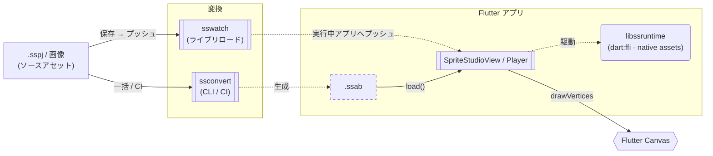

# SpriteStudioPlayer for Flutter

**OPTPiX SpriteStudio 7** のラスター（スプライト）アニメーション（`.ssab`）を Flutter でそのまま再生
します。アーティストが専用エディタでリグを組み、Flutter の `Canvas` に直接描画 —— 手書きの
アニメーションコードは不要です。再生処理は
[SpriteStudio-SDK](https://github.com/cri-middleware/SpriteStudio-SDK) が提供する `libssruntime`
を介して行います。

!!! tip "SpriteStudio を初めて使う方へ"
    [OPTPiX SpriteStudio 7](https://www.webtech.co.jp/spritestudio/) はプロ向けの 2D **ラスター**
    アニメーションエディタです。スプライト素材にボーン・メッシュ変形・パーティクルを載せて、
    モーションを視覚的に作れます。アーティストが動きを作り、このプレイヤーが完成ファイルを再生
    します。ベクター系のツールとは用途が異なり、`.gif` や `.mp4` を同梱するより軽量です。

## 目次

- **セットアップ**
    - [インストール](guide/install.md)
    - [クイックスタート](guide/quickstart.md)
- **ワークフロー**
    - [再生制御とイベント](guide/playback.md)
    - [Flame との連携](guide/flame.md)
    - [アセットの準備（`.sspj` → `.ssab`）](guide/conversion.md)（初回の変換はこちら）
    - [ライブリロード](guide/live-reload.md)
- **応用**
    - [アーキテクチャ](contributing/architecture.md)
    - [ビルドガイド](contributing/build.md)
    - [ネイティブランタイム](contributing/native-runtime.md)
    - [リリース](contributing/releasing.md)
- **リファレンス**
    - [パッケージ](packages.md)
    - [API リファレンス](api.md)
- [ロードマップと制約事項](contributing/roadmap.md)

## 主な機能 (Key Features)

このプレイヤーは、SpriteStudio 7 の表現力をフルに引き出しつつ、手書きのアニメーションコードを
一切書かずに済むように設計されています。

*   **アニメーションコードはゼロ:** キャラクター・**UI・シーン全体**を SpriteStudio 7 で作り、`play()` を呼ぶだけ。
*   **完全な機能サポート:** 全コア描画種別（Normal・PartColor・Mask・Mesh・Effect（パーティクル）・Instance・Shape）に加え、ボーン階層とメッシュ変形を標準サポート。
*   **ネイティブな Canvas 描画:** `dart:ffi` で Rust ランタイムを駆動し `Canvas.drawVertices` で描画。WebView でも動画デコードでもありません。
*   **ウィジェットツリーに、[Flame](guide/flame.md) にも合成:** `SpriteStudioView` は普通の `RenderBox`。`ssplayer_flame` パッケージが `SpriteStudioComponent` を追加します。
*   **滑らかなサブフレーム補間:** ディスプレイのリフレッシュレートに追従（固定 fps ではありません）—— スローモーションでもカクつきません。
*   **自分の素材を、ライブリロードで:** `.sspj` → `.ssab` を [CLI / CI](guide/conversion.md) で変換し、エディタでの編集を **[ライブリロード](guide/live-reload.md)** で実行中アプリへそのまま反映。
*   **超高速・省メモリ:** SIMD 最適化ランタイムとパース不要なバイナリ形式（`.ssab`）。ネイティブランタイムは native assets により自動同梱 —— CocoaPods も手動リンクも不要です。

## 概要 (Overview)

アセットが画面上の再生に至るまでのデータの流れを以下に示します。

## 対応バージョン

- **Flutter**: 3.38 以降 / **Dart**: 3.10 以降（この世代で native assets が安定・デフォルト有効になります）。
- **プラットフォーム**: macOS・iOS（シミュレータ）・Android（エミュレータ）で確認済み。実機 iOS と Web は未確認です —— [ロードマップと制約事項](contributing/roadmap.md) を参照してください。

## サンプル

リポジトリの `examples/` フォルダにサンプルアプリがあります。

- [overall](https://github.com/cri-middleware/SSPlayerForFlutter/tree/main/examples/overall) — 総合的な検証アプリ（`flutter run -d macos` → `[ssplayer] OK`）。
- [flame](https://github.com/cri-middleware/SSPlayerForFlutter/tree/main/examples/flame) — `ssplayer_flame` 経由でアニメーションを再生する `FlameGame`。

## 関連リポジトリ

- [SpriteStudio-SDK](https://github.com/cri-middleware/SpriteStudio-SDK) — `libssruntime` / `libssconverter` を提供する SDK 本体。
- 他エンジン向けの兄弟プレイヤー: [Godot](https://github.com/cri-middleware/SSPlayerForGodot)・[Unity](https://github.com/cri-middleware/SSPlayerForUnity)・[Web](https://github.com/cri-middleware/SSPlayerForWeb)・[Ren'Py](https://github.com/cri-middleware/SSPlayerForRenPy)。

## ライセンス

[LICENSE.md](https://github.com/cri-middleware/SSPlayerForFlutter/blob/main/LICENSE.md) を参照してください。

サードパーティライブラリ（FlatBuffers, SpriteStudio-SDK の依存クレートなど）のライセンスについては、[THIRD_PARTY_NOTICES.md](https://github.com/cri-middleware/SSPlayerForFlutter/blob/main/THIRD_PARTY_NOTICES.md) を参照してください。
