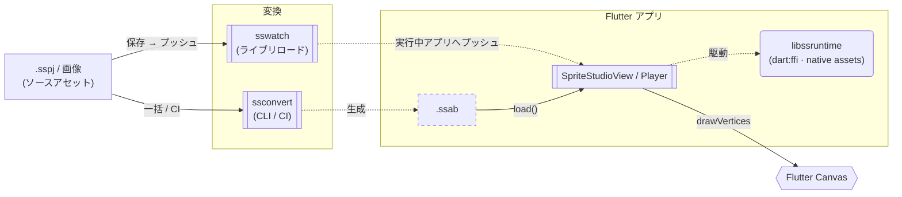

# 📱 SpriteStudio Player for Flutter

**SpriteStudio** のラスター（スプライト）アニメーション（`.ssab`）を Flutter でそのまま再生します。アーティストが専用エディタでリグを組み、Flutter 自身のレンダラで描画 —— 手書きのアニメーションコードは不要です。再生処理は
[SpriteStudio-SDK](https://github.com/cri-middleware/SpriteStudio-SDK) が提供する `libssruntime`
を介して行います。

!!! tip "SpriteStudio を初めて使う方へ"
    [SpriteStudio](https://www.webtech.co.jp/spritestudio/) はプロ向けの 2D **ラスター**アニメーションエディタです。スプライト素材にボーン・メッシュ変形・パーティクルを載せて、モーションを視覚的に作れます。アーティストが動きを作り、このプレイヤーが完成ファイルを再生します。ベクター系のツールとは用途が異なり、`.gif` や `.mp4` を同梱するより軽量です。手元にデータが無くても始められます —— [公式のサンプルデータ](https://www.webtech.co.jp/help/ja/spritestudio7/download/sample/)
    （[Ringo](https://www.webtech.co.jp/help/ja/spritestudio7/download/sample/#ringo) /
    [パーティクル](https://www.webtech.co.jp/help/ja/spritestudio7/download/sample/#Perticle_sample)）がそのまま使えます。

!!! example "ブラウザで試す"
    [**Web デモ**](../demo/) はこのドキュメントの隣に 2 つ公開しています。`ssplayer_flutter`
    のウィジェットを動かす `examples/overall` と、`ssplayer_flame` を動かす `examples/flame`
    です。いずれも Flutter の Web ビルドが読み込むのと同じ `libssruntime` の wasm 上で動きます。
    Web ターゲットは developer preview です（[制約と適用範囲](limitations.md) を参照）。

## 目次

- **セットアップ**
    - [インストール](guide/install.md)
- **ワークフロー**
    - [クイックスタート](guide/quickstart.md)
    - [再生制御とイベント](guide/playback.md)
    - [モーションブレンド](guide/motion-blending.md)
    - [パーツトラッキング](guide/part-following.md)
    - [パーツオーバーライド](guide/part-overrides.md)
    - [テクスチャ差し替え](guide/textures.md)
    - [Flame との連携](guide/flame.md)
    - [アセットの準備（`.sspj` → `.ssab`）](guide/conversion.md)（初回の変換はこちら）
    - [ライブリロード](guide/live-reload.md)
- [**API リファレンス**](api.md)
- [**制約と適用範囲**](limitations.md)
- **コントリビューター向け**
    - [ビルドガイド](contributing/build.md)
    - [アーキテクチャ](contributing/architecture.md)
    - [ネイティブランタイム](contributing/native-runtime.md)
- [**パッケージ**](packages.md)

## 主な機能 (Key Features)

このプレイヤーは、SpriteStudio の表現力をフルに引き出しつつ、手書きのアニメーションコードを一切書かずに済むように設計されています。

*   **アニメーションコードはゼロ:** キャラクター・**UI・シーン全体**を SpriteStudio で作り、ウィジェット 1 つで再生します。
*   **完全な機能サポート:** 全コア描画種別（Normal・PartColor・Mask・Mesh・Effect（パーティクル）・Instance・Shape）に加え、ボーン階層とメッシュ変形を標準サポート。
*   **ネイティブ GPU 描画:** `dart:ffi` で Rust ランタイムを駆動し、Flutter 自身のレンダラで描画（Impeller では `flutter_gpu`、それ以外は `Canvas.drawVertices`）。WebView でも動画デコードでもありません。
*   **ウィジェットツリーに、[Flame](guide/flame.md) にも合成:** `SpriteStudioView` は普通の `RenderBox`。`ssplayer_flame` パッケージが `SpriteStudioComponent` を追加します。
*   **ランタイムのテクスチャ差し替え（着せ替え・カラバリ）:** セルマップが参照するビットマップを実行時に差し替え —— カラーバリエーション・装備変更・表情差分を [`setCellmapTexture()`](guide/textures.md) で。組み合わせごとのアニメーションは不要です。
*   **モーションブレンド:** アニメ同士をカットせず[クロスフェード](guide/motion-blending.md)でつなぎ、歩きの上に狙いやリアクションを重ね、歩きと走りを weight で混ぜる —— どれも別々に作ったアニメから組み立てられます。
*   **滑らかなサブフレーム補間:** ディスプレイのリフレッシュレートに追従（固定 fps ではありません）—— スローモーションでもカクつきません。
*   **自分の素材を、ライブリロードで:** `.sspj` → `.ssab` を [CLI / CI](guide/conversion.md) で変換し、エディタでの編集を **[ライブリロード](guide/live-reload.md)** で実行中アプリへそのまま反映。
*   **リンク作業は不要:** ネイティブランタイムは native assets により自動同梱 —— CocoaPods も手動リンクも不要です。

## 概要 (Overview)

アセットが画面上の再生に至るまでのデータの流れを以下に示します。

## 対応バージョン

- **Flutter / Dart**: 下限は[インストール](./guide/install.md)にあり、実際に強制するのは `ssplayer_flutter` の `environment:` です。native assets の下限より上にあるのは、GPU バックエンドが flutter_gpu の現行 API に対してビルドされるためです。
- **プラットフォーム**: macOS・Windows・Linux・iOS・Android・Web（開発者プレビュー）。

## サンプル

リポジトリの `examples/` フォルダにサンプルアプリがあります。

- [overall](https://github.com/cri-middleware/SSPlayerForFlutter/tree/main/examples/overall) — 総合的な検証アプリ（`flutter run -d macos` → `[ssplayer] OK`）。
- [flame](https://github.com/cri-middleware/SSPlayerForFlutter/tree/main/examples/flame) — `ssplayer_flame` 経由でアニメーションを再生する `FlameGame`。
- [part_following](https://github.com/cri-middleware/SSPlayerForFlutter/tree/main/examples/part_following) — `SpriteStudioPartAnchor` でウィジェットをパーツに追従させるサンプル。

## 関連リポジトリ

- [SpriteStudio Docs](https://cri-middleware.github.io/SpriteStudio-Docs/ja/) — SDK と公式 Player のドキュメントポータル。
- [SpriteStudio-SDK](https://github.com/cri-middleware/SpriteStudio-SDK) — `libssruntime` / `libssconverter` を提供する SDK 本体。
- [SSConverterGUI](https://github.com/cri-middleware/SSConverterGUI) — Player を介さず `.sspj` を変換するデスクトップ GUI。

## ライセンス

[LICENSE.md](https://github.com/cri-middleware/SSPlayerForFlutter/blob/main/LICENSE.md) を参照してください（参考訳: [LICENSE.ja.md](https://github.com/cri-middleware/SSPlayerForFlutter/blob/main/LICENSE.ja.md)）。

サードパーティライブラリ（FlatBuffers, SpriteStudio-SDK の依存クレートなど）のライセンスについては、[THIRD_PARTY_NOTICES.md](https://github.com/cri-middleware/SSPlayerForFlutter/blob/main/THIRD_PARTY_NOTICES.md) を参照してください。
